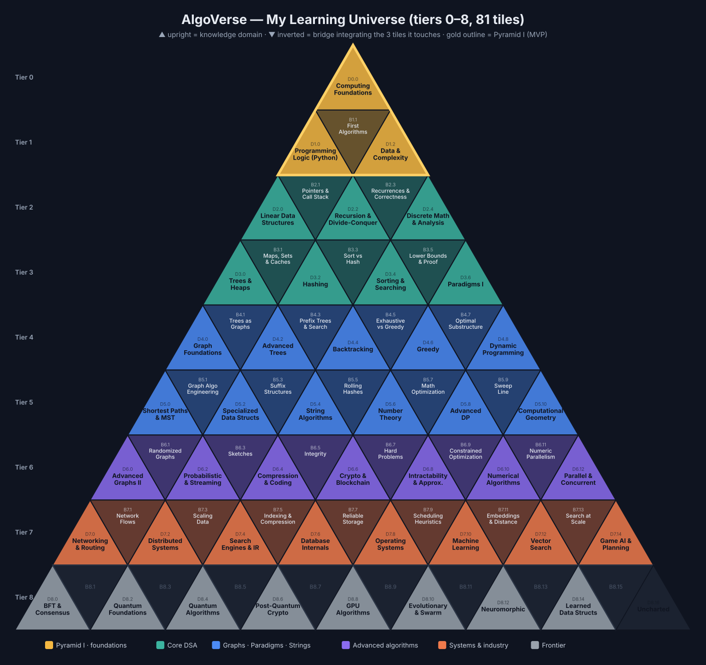

# AlgoVerse — Explore. Visualize. Experiment. Master.

An interactive computer-science and algorithm learning laboratory. Learners go from *"What is an algorithm?"* to database internals, distributed systems, vector search and beyond, watching **real Python execute** while the data structures change in synchronized, step-by-step visualizations.

## Status

**Phase 1: Product & Engineering Blueprint.** Drafted and awaiting review. No application code yet, by design.

Start with **[docs/BLUEPRINT.md](docs/BLUEPRINT.md)**.

## Documentation

| Document | Purpose |
|---|---|
| [BLUEPRINT](docs/BLUEPRINT.md) | Entry point: summary, deliverables index, MVP, key decisions, open questions |
| [PRD](docs/PRD.md) | Product requirements & detailed feature specification |
| [CURRICULUM](docs/CURRICULUM.md) | Complete learning hierarchy (9 tiers, 81 tiles, ~665 concepts) |
| [PYRAMID_MODEL](docs/PYRAMID_MODEL.md) | Expanding pyramid learning architecture |
| [LEARNING_DESIGN](docs/LEARNING_DESIGN.md) | 12-section lesson template & pedagogy |
| [CONTENT_SCHEMA](docs/CONTENT_SCHEMA.md) | Content-as-code schemas & verification pipeline |
| [VISUALIZATION_ENGINE](docs/VISUALIZATION_ENGINE.md) | Trace-driven animation & execution design |
| [EXECUTION_ENGINE](docs/EXECUTION_ENGINE.md) | Python sandbox, tracer & debugger |
| [ARCHITECTURE](docs/ARCHITECTURE.md) | Technical architecture, stack, security, deployment, folder structure |
| [DATA_MODEL_AND_API](docs/DATA_MODEL_AND_API.md) | Database schema & REST API |
| [UI_UX](docs/UI_UX.md) | Design language & screen specifications |
| [GAMIFICATION](docs/GAMIFICATION.md) | Assessment, mastery, adaptive learning & gamification |
| [TESTING](docs/TESTING.md) | QA strategy |
| [ROADMAP](docs/ROADMAP.md) | Implementation phases, detailed MVP plan, risks |
| [PROGRESS](docs/PROGRESS.md) | Completed and pending work |
| [DECISIONS](docs/DECISIONS.md) | Architecture decision records |
