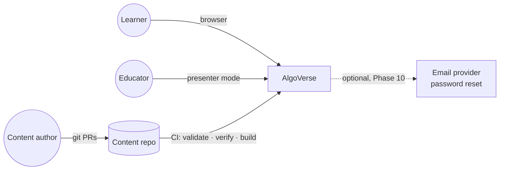
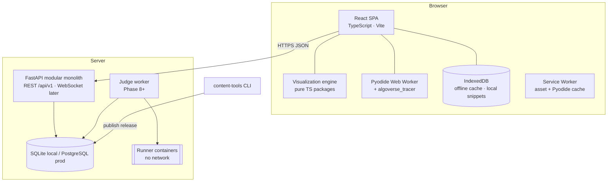
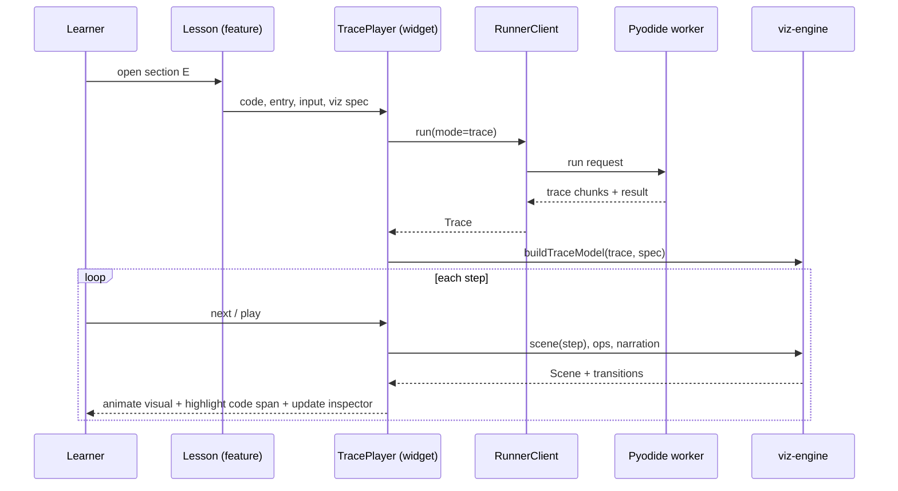
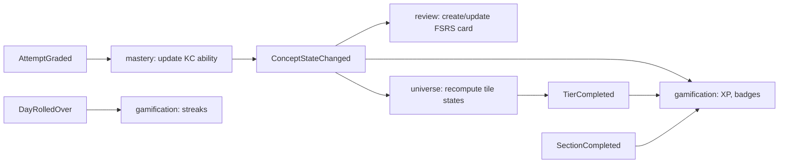

# AlgoVerse — Technical Architecture

> Deliverable 9 (architecture & technology stack), Deliverable 14 (initial folder structure), plus the security architecture and deployment strategy.
> Detailed sub-designs: [VISUALIZATION_ENGINE](VISUALIZATION_ENGINE.md) · [EXECUTION_ENGINE](EXECUTION_ENGINE.md) · [CONTENT_SCHEMA](CONTENT_SCHEMA.md) · [DATA_MODEL_AND_API](DATA_MODEL_AND_API.md).

---

## 1. Architectural drivers

| Driver | Consequence |
|---|---|
| Truthful, synchronized visuals | Trace-driven engine; shared trace schema across Python and TS |
| Safe code execution | Learner code never runs on the server in MVP (Pyodide in a Web Worker) |
| Hundreds of topics, thousands of activities | Content-as-data, compiled bundles, lazy per-tile loading |
| Hosted web app, installable PWA, no paid dependencies | FastAPI + static SPA behind a reverse proxy; anonymous guest learners; Service Worker (Workbox) for install/offline; self-hosted Pyodide |
| Long-term growth by a small team | **Modular monolith**: strict module boundaries, one deployable, cheap to operate |
| Testability | Engine and domain logic are pure functions/services; UI is a thin shell |

---

## 2. System context (C4 level 1)



There are no external runtime dependencies for core functionality: no AI APIs, no third-party analytics, no CDN required.

## 3. Containers (C4 level 2)



| Container | Tech | Responsibility |
|---|---|---|
| SPA | React 19, TypeScript, Vite | All UI. Hosts engine + worker |
| Visualization engine | TypeScript packages (`packages/viz-engine`) | Trace → scene → animation. No React dependency |
| Python worker | Pyodide (pinned), `algoverse_tracer` wheel | Executes and traces Python |
| API | Python 3.12+, FastAPI, SQLAlchemy 2, Alembic, Pydantic v2 | Content serving, progress, assessment grading, gamification, adaptive engine, auth |
| Database | SQLite (local/dev), PostgreSQL 16+ (prod) | Persistent state + published content |
| content-tools | Python CLI | Validate, verify, compile, publish content |
| Judge (later) | Python worker + Docker/gVisor | Server-authoritative execution |

---

## 4. Technology selection (with justification)

### 4.1 Frontend

| Concern | Choice | Why | Rejected alternatives |
|---|---|---|---|
| Framework | **React 19 + TypeScript (strict)** | Brief requirement; ecosystem; concurrent rendering for smooth UI | — |
| Build | **Vite** | Fast HMR, first-class workers & WASM, simple config | Next.js (SSR unnecessary; complicates COOP/COEP + workers) |
| Routing | **React Router** (data routers) | Mature, code-splitting per route | TanStack Router (good, but less familiar to contributors) |
| Server state | **TanStack Query** | Caching, retries, optimistic progress updates | Redux Toolkit Query (heavier) |
| Client state | **Zustand** (small stores per feature) | Minimal, works outside React (engine/playback) | Redux (boilerplate), Context only (re-render storms) |
| Styling | **Tailwind CSS v4 + CSS variables (design tokens)** | Consistent tokens, theming, small CSS | CSS-in-JS (runtime cost) |
| Accessible primitives | **Radix UI primitives** | Accessible dialogs, menus, tabs, sliders | Building our own (risky for a11y) |
| Code editor | **CodeMirror 6** | Light (vs Monaco), excellent line/range decorations for execution highlighting, mobile-friendly, extensible | Monaco (heavy ~2–3 MB, poor mobile) |
| Algorithm visuals | **Custom SVG + Canvas renderers** driven by our scene model + **custom tween engine** | Full control, truthfulness, Canvas parity, testable | Framer Motion for viz (DOM-bound, no Canvas parity); PixiJS (unneeded until > 10k primitives) |
| Layout math | **d3-hierarchy, d3-force, d3-scale, d3-shape, d3-zoom** (modules only, no D3 DOM manipulation) | Proven algorithms, tree-shakeable | Full D3 (DOM ownership conflicts with React) |
| Node-link editors (DS builder, dependency explorer) | **React Flow (@xyflow/react)** | Drag/connect/zoom out of the box, custom nodes | Hand-rolled (lots of interaction code) |
| Learning Universe | **Custom SVG + d3-zoom** | Triangular geometry & semantic zoom are custom anyway | React Flow (rectangular-node model fights triangles) |
| UI motion | **Motion (Framer Motion)** for panels/toasts/ceremonies only | Nice UI transitions | — |
| Charts (complexity, progress) | **Custom with d3-scale/d3-shape** (+ small chart components) | Avoids a chart dependency; consistent tokens | Recharts (acceptable fallback) |
| Markdown | **unified/remark + remark-directive + rehype** → React | Directive blocks for widgets; safe (no raw HTML) | MDX (mixes code into content) |
| Math | **KaTeX** | Fast math typesetting for complexity/proofs | MathJax (heavier) |
| i18n | **i18next** | Externalized strings from day one | — |
| Testing | Vitest, Testing Library, Playwright, axe-core | See [TESTING](TESTING.md) | — |

### 4.2 Backend

| Concern | Choice | Why |
|---|---|---|
| Language | **Python 3.12+** | Brief requirement; shares tracer/content tooling |
| Web framework | **FastAPI** | Typed, async, OpenAPI generation → typed TS client |
| ORM / migrations | **SQLAlchemy 2.0 + Alembic** | Mature, supports SQLite & PostgreSQL with one codebase |
| Validation | **Pydantic v2** | Shared with content-tools schemas |
| Auth | Session cookie (httpOnly, SameSite=Lax) + CSRF token; **Argon2id** (`argon2-cffi`) | Simpler and safer than JWTs in browser storage |
| Spaced repetition | **FSRS** (`fsrs` Python package, MIT) | Modern, open, better than SM-2 |
| Background jobs | In-process scheduler for light tasks (streak rollover, daily challenge); DB job table for the Judge | No broker needed initially |
| Logging | `structlog` JSON logs; request IDs | Debuggable locally and in prod |
| Packaging | **uv** (Python), **pnpm** workspaces (JS) | Fast, reproducible, monorepo-friendly |

### 4.3 Database
- **SQLite** for local development and small single-server deployments (single file, zero setup, `WAL` mode).
- **PostgreSQL** for production (concurrency, `JSONB`, `SKIP LOCKED` job queue, robust backups).
- Portability rules: SQLAlchemy core types only. JSON columns via a `JSON().with_variant(JSONB, "postgresql")` type. No DB-specific SQL outside the repository layer. CI runs tests against **both** engines.

---

## 5. Frontend architecture

### 5.1 Layers

```text
apps/web/src
├── app/            # shell: router, providers, layout, error boundaries, theme
├── features/       # vertical slices; each owns routes, components, hooks, stores
│   ├── dashboard/  universe/  curriculum/  lesson/  algo-lab/  ds-lab/
│   ├── playground/ problems/  projects/    progress/ library/  settings/
├── widgets/        # cross-feature composites: TracePlayer, CodePanel, Inspector, ComplexityChart
├── runtime/        # RunnerClient, worker entry, protocol types (from trace-schema)
├── content/        # content client, markdown renderer, directive → widget registry
├── api/            # generated OpenAPI client + TanStack Query hooks
├── ui/             # design system (tokens, Radix-based primitives)
└── lib/            # utilities (i18n, keyboard shortcuts, analytics events)
packages/viz-engine # trace-model, semantic, adapters, scene, animator, renderers, playback, narration, expr
packages/trace-schema # JSON Schema → TS types (+ Pydantic for Python)
```

**Dependency rules** (enforced with `eslint-plugin-boundaries`): `features` may import `widgets`, `ui`, `api`, `content`, `runtime`, `lib`. `widgets` may not import `features`. `packages/viz-engine` imports nothing from `apps/web`. Features never import each other; they communicate through the router or shared stores.

### 5.2 Key runtime flows



### 5.3 Installable PWA & offline
- **PWA** ([ADR-020](DECISIONS.md)): web app manifest + icons; `vite-plugin-pwa` (Workbox) with `registerType: "prompt"`, so an "update available" toast appears instead of a silent reload mid-lesson.
- The Service Worker must serve cached responses **with** their COOP/COEP/CORP headers. Otherwise `crossOriginIsolated`, which Pyodide's interrupts need, is lost once the app is installed. An E2E test pins this.
- The Service Worker caches the app shell, Pyodide and the compiled content bundle for opened tiles.
- Progress events are queued in IndexedDB when the API is unreachable and replayed with idempotency keys.

---

## 6. Backend architecture (modular monolith)

```text
apps/api/app
├── main.py                 # app factory, middleware, router mounting
├── core/                   # config, db session, security, errors (RFC 9457), events bus, clock
├── modules/
│   ├── auth/               # guest sessions (cookie), CSRF; accounts later
│   ├── users/              # profile, preferences, export/delete
│   ├── content/            # releases, catalog queries, graph queries (ancestors, paths)
│   ├── universe/           # tile/concept state projection for the map
│   ├── progress/           # learning events, section completion, concept state machine
│   ├── assessment/         # items, attempts, server-side grading, item instance pools
│   ├── mastery/            # Elo per knowledge component, mastery decisions, misconceptions
│   ├── review/             # FSRS scheduling
│   ├── gamification/       # XP ledger, levels, badges, streaks, goals, challenges
│   ├── recommend/          # next-best-activity
│   ├── problems/           # problem catalog, submissions (client- or judge-graded)
│   ├── playground/         # saved snippets
│   ├── execution/          # Judge job API (Phase 8)
│   └── analytics/          # privacy-preserving event log, aggregates
└── tests/
```

Each module has `router.py` (HTTP), `service.py` (use cases), `repository.py` (DB), `models.py` (ORM), `schemas.py` (Pydantic), `events.py` (domain events). Modules call each other **only through services or domain events**, never through another module's repository or models (checked by `import-linter`).

**Domain events (in-process bus, transactional outbox later if needed):**



---

## 7. Security architecture

| Area | Controls |
|---|---|
| Code execution | See [EXECUTION_ENGINE §5–6](EXECUTION_ENGINE.md#5-sandboxing--resource-limits-browser). No learner code on the API host |
| Transport | HTTPS in prod (TLS at reverse proxy), HSTS |
| Browser hardening | CSP: `default-src 'self'; script-src 'self' 'wasm-unsafe-eval'; connect-src 'self'; img-src 'self' data:; style-src 'self' 'unsafe-inline'` (tightened with hashes later); COOP/COEP for isolation; `X-Content-Type-Options`, `Referrer-Policy` |
| AuthN | Argon2id hashes; session cookies (httpOnly, Secure, SameSite=Lax); session rotation on login; rate-limited login; MVP: anonymous guest learner per browser (random 256-bit session token, hashed at rest, httpOnly cookie); accounts adopt guest progress later |
| AuthZ | Role-based (`learner`, `author`, `admin`); per-row ownership checks in services; default deny |
| CSRF | Double-submit token header on mutating requests |
| Input validation | Pydantic models on every endpoint; size limits; content directives whitelisted; Markdown rendered without raw HTML |
| Assessment integrity | Answer keys for server-graded items never sent to the client before an attempt. Item instances are drawn server-side |
| Data protection | Minimal PII; export & delete account; backups encrypted at rest (prod) |
| Supply chain | Lockfiles (`pnpm-lock.yaml`, `uv.lock`), Renovate/Dependabot, `pip-audit`, `pnpm audit`, pinned & self-hosted Pyodide with SRI hashes |
| Abuse | Rate limiting (per IP/user) on auth, attempts, executions; request body caps |

---

## 8. Deployment strategy

| Target | How | Notes |
|---|---|---|
| **Local development** | `pnpm dev` (Vite with COOP/COEP headers) + `uv run fastapi dev` + SQLite | Hot reload both sides. `make dev` runs both |
| **Small self-hosted instance** | `docker compose -f infra/compose.local.yml up` (single process: FastAPI serves the built SPA + SQLite) | Same app as production with a smaller footprint; guest learners |
| **Production** | `infra/compose.prod.yml`: `caddy` (TLS, headers, static) → `api` (gunicorn + uvicorn workers) → `postgres`; optional `judge` | One VM is enough initially; stateless API allows horizontal scaling |
| **Database migration** | Alembic migrations run on startup (local) / as a release step (prod). Expand-and-contract for zero-downtime changes | CI checks migration up/down on SQLite + Postgres |
| **Content release** | CI builds the bundle → `content-tools publish` → new `content_release` row; API serves the active release | Rollback = activate previous release |
| **Backup & recovery** | Postgres: nightly `pg_dump` + WAL archiving (PITR) to object storage; SQLite: online `.backup` daily + "Export my progress" JSON | Quarterly restore drill (documented runbook) |
| **Observability** | Structured logs, request IDs, `/healthz`, `/readyz`; OpenTelemetry tracing optional (Phase 10) | No third-party telemetry by default |

CI/CD (GitHub Actions): lint → type-check → unit → content CI → integration (SQLite & Postgres) → E2E (Playwright) → build images → (main) deploy to staging.

---

## 9. Initial project folder structure (Deliverable 14)

```text
cl_dsa/
├── README.md
├── docs/                              # all blueprint & living docs (this folder)
│   ├── BLUEPRINT.md  PRD.md  CURRICULUM.md  PYRAMID_MODEL.md  LEARNING_DESIGN.md
│   ├── CONTENT_SCHEMA.md  VISUALIZATION_ENGINE.md  EXECUTION_ENGINE.md  ARCHITECTURE.md
│   ├── DATA_MODEL_AND_API.md  UI_UX.md  GAMIFICATION.md  TESTING.md
│   ├── ROADMAP.md  PROGRESS.md  DECISIONS.md
│   ├── assets/                        # diagrams
│   └── plans/                         # per-phase implementation plans
├── apps/
│   ├── web/                           # React SPA
│   │   ├── src/{app,features,widgets,runtime,content,api,ui,lib}/
│   │   ├── public/pyodide/            # self-hosted, pinned Pyodide distribution (fetched by script)
│   │   ├── tests/                     # Vitest (unit/component)
│   │   └── e2e/                       # Playwright specs
│   └── api/                           # FastAPI modular monolith
│       ├── app/{core,modules/*}/
│       ├── alembic/
│       └── tests/{unit,integration}/
├── packages/
│   ├── trace-schema/                  # JSON Schema (source of truth) → TS types + Pydantic models
│   ├── viz-engine/                    # TS: trace-model, semantic, adapters, scene, animator, renderers, playback, narration, expr
│   ├── tracer/                        # Python: algoverse_tracer (instrument, trace, serialize, limits) + wheel build
│   └── content-tools/                 # Python CLI: validate, graph, test, verify-complexity, build, publish
├── content/                           # curriculum data (tiles, concepts, problems, projects, badges, references)
├── services/
│   └── judge/                         # Phase 8: job worker + runner image
├── infra/
│   ├── compose.local.yml  compose.prod.yml  Caddyfile
│   └── docker/{api,web,judge,runner}.Dockerfile
├── scripts/                           # dev helpers (fetch-pyodide, seed, gen-types)
├── .github/workflows/ci.yml
├── package.json  pnpm-workspace.yaml  # JS workspace
├── pyproject.toml  uv.lock            # Python workspace (api, tracer, content-tools)
└── Makefile                           # dev, test, lint, content-build, e2e
```
