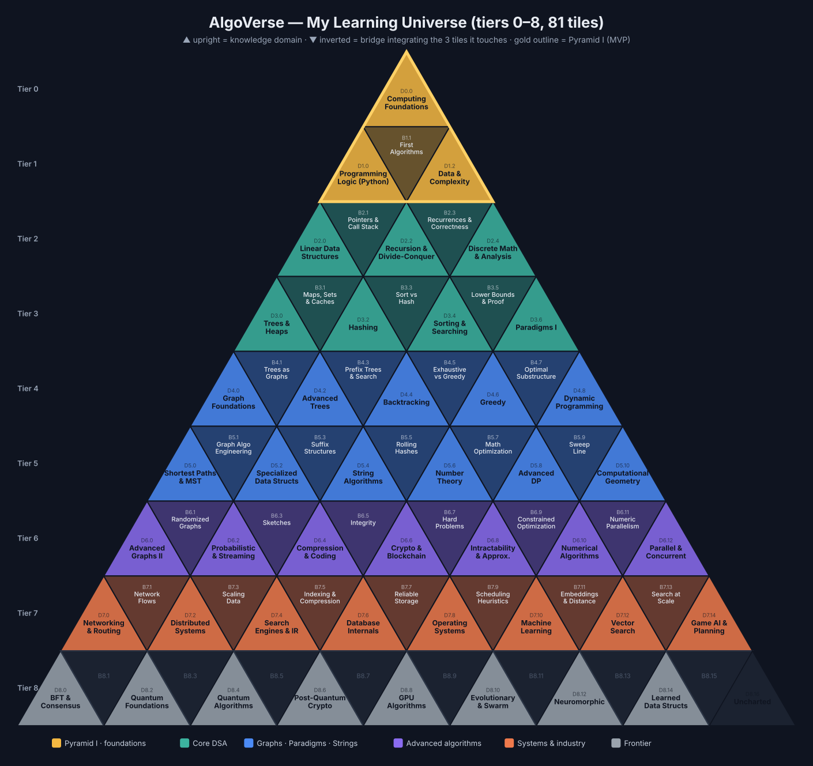

# AlgoVerse — Product & Engineering Blueprint (Phase 1)

> **Explore. Visualize. Experiment. Master.**
> Start here. This document summarizes the blueprint, indexes the 15 deliverables, and closes with the MVP scope, the first pyramid, the development sequence, the key decisions and the open questions.



---

## 1. The blueprint in one page

**What we are building.** An interactive computer-science laboratory that takes a learner from *"What is an algorithm?"* to database engines, distributed consensus, vector search and quantum algorithms. Every concept follows one 12-section lesson template, and every algorithm is shown **running as real Python**: the visualization on the left, the code on the right, highlighted and synchronized step by step.

**The one idea everything rests on.** Visualizations are **derived from a real execution trace**, never hand-scripted:

```text
Python code ──► instrumented run in the browser (Pyodide) ──► execution trace (data)
                                                                │
          ┌──────────────────────┬─────────────────────┬────────┴────────┬──────────────────────┐
          ▼                      ▼                     ▼                 ▼                      ▼
   animated visuals      code-line highlight    state inspector   Time Machine /      auto-generated,
   (array, tree, graph…)  (exact sub-expression) & call stack     Battle Arena        always-correct questions
```

As a result, animations cannot lie, learner-modified code is visualized truthfully, stepping backwards is exact, and practice questions never run out.

**How the curriculum is organized.** An **expanding triangular pyramid**. Upright tiles are knowledge domains and inverted tiles are bridges that integrate their three neighbouring domains. Each completed tier grows the whole pyramid into a larger triangle (1 → 4 → 9 → 16 … tiles). Underneath, a real prerequisite graph drives unlocking, so alternative learning paths are possible.

**How learning is measured.** Mastery comes only from evidence: predictions on live traces, Parsons problems, find-the-bug, code-with-tests and checkpoints. Watching earns nothing. Spaced repetition (FSRS) keeps knowledge fresh, and misconception tracking drives targeted remediation.

**How it is built.** React + TypeScript SPA with a pure-TS visualization engine. Pyodide in a sandboxed Web Worker for Python. FastAPI modular monolith. SQLite locally, PostgreSQL in production. Content as code (YAML + Markdown + Python) verified by CI, including empirical complexity checks. No paid APIs. Hosted web app, installable as a PWA.

---

## 2. Deliverables index

| # | Deliverable | Where |
|---|---|---|
| 1 | Product vision & product requirements | [PRD.md](PRD.md) §1–7 |
| 2 | Complete curriculum & concept hierarchy | [CURRICULUM.md](CURRICULUM.md) |
| 3 | Expanding pyramid learning architecture (visual) | [PYRAMID_MODEL.md](PYRAMID_MODEL.md) |
| 4 | Detailed feature specification (17 modules: purpose, features, dependencies, implementation, UX, testing, acceptance) | [PRD.md §8](PRD.md#8-detailed-feature-specification-deliverable-4) |
| 5 | Learning experience & lesson design | [LEARNING_DESIGN.md](LEARNING_DESIGN.md) |
| 6 | Algorithm visualization engine architecture (+ Time Machine) | [VISUALIZATION_ENGINE.md](VISUALIZATION_ENGINE.md) |
| 7 | Python execution & debugging architecture | [EXECUTION_ENGINE.md](EXECUTION_ENGINE.md) |
| 8 | UI/UX design & screen-by-screen specifications | [UI_UX.md](UI_UX.md) |
| 9 | Technical architecture & technology stack | [ARCHITECTURE.md](ARCHITECTURE.md) |
| 10 | Database schema & API architecture | [DATA_MODEL_AND_API.md](DATA_MODEL_AND_API.md) |
| 11 | Gamification & adaptive learning | [GAMIFICATION.md](GAMIFICATION.md) |
| 12 | Testing & QA strategy | [TESTING.md](TESTING.md) |
| 13 | Phased implementation roadmap + detailed MVP plan | [ROADMAP.md](ROADMAP.md) |
| 14 | Initial project folder structure | [ARCHITECTURE.md §9](ARCHITECTURE.md#9-initial-project-folder-structure-deliverable-14) |
| 15 | Risk assessment & technical recommendations | [ROADMAP.md §6](ROADMAP.md#6-risk-assessment--mitigation-deliverable-15) |
| + | Content architecture & schemas | [CONTENT_SCHEMA.md](CONTENT_SCHEMA.md) |
| + | Architecture decision records | [DECISIONS.md](DECISIONS.md) |
| + | Progress tracker | [PROGRESS.md](PROGRESS.md) |

Additional product recommendations from the brief and where each one is designed:

| Brief § | Capability | Designed in |
|---|---|---|
| 18 | Algorithm Time Machine | [VISUALIZATION_ENGINE §13](VISUALIZATION_ENGINE.md#13-algorithm-time-machine-brief-18) |
| 19 | Build Your Own Data Structure | [PRD M8](PRD.md#m8-data-structure-laboratory-build-your-own), [UI_UX §3.6](UI_UX.md#36-data-structure-laboratory) |
| 20 | Algorithm Battle Arena | [PRD M7](PRD.md#m7-algorithm-laboratory), [UI_UX §3.5](UI_UX.md#35-algorithm-laboratory) |
| 21 | Concept Dependency Explorer | [PRD M15](PRD.md#m15-knowledge-library--concept-dependency-explorer) |
| 22 | Algorithm Reverse Engineering | [PRD M7](PRD.md#m7-algorithm-laboratory), [ROADMAP Phase 8](ROADMAP.md#3-later-phases--scope-and-acceptance-criteria) |

---

## 3. Gaps found in the brief (added to the design)

| Gap | Why it matters | Resolution |
|---|---|---|
| **Placement / test-out** | Experienced learners would be forced through basics | Checkpoint-based test-out per concept; a diagnostic placement path through Tier 0–1 checkpoints |
| **Intractability (P vs NP, reductions)** missing from the topic list | Core CS literacy; explains why approximation exists | Added tile D6.8 |
| **Probability foundations** | Needed for hashing, randomized algorithms, sketches | Added `probability-basics` to D2.4 |
| **Compression & coding** only mentioned via projects | Needed by search engines and storage internals | Added tile D6.4 |
| **How to assess "explain" without AI** | The brief forbids paid AI dependencies | `explain-by-reasons` item type |
| **Content correctness at scale** | The brief demands accuracy for ~665 lessons | Content CI: tests, property tests, fidelity tests, empirical complexity verification, `review_by` dates |
| **Shared/untrusted code** | Future sharing would run others' code | Untrusted-mode iframe isolation before sharing is enabled |
| **Accessibility of a visual-first product** | Visuals exclude screen-reader users by default | Narration per step, list views, keyboard activities, pattern-encoded states |
| **Content versioning vs learner progress** | Content will change under learners | Stable concept IDs, releases, aliases, assessment versions |
| **Data ownership & privacy** | Privacy promise | Export/delete, no third-party analytics, pseudonymous events |

---

## 4. Recommended MVP scope

**MVP = Phases 2–4 = Pyramid I, delivered as an excellent, complete, local learning experience.**

In scope:
- Learning Universe with Pyramid I live and the rest of the universe visible in fog (the learner sees the journey ahead).
- 34 complete lessons (12-section template) across D0.0, D1.0, D1.2 and B1.1, plus the *Search & Sort Showdown* capstone and ~20 problems.
- Trace-driven visualization engine with array, bars, search, variables, call-stack and basic memory views. Full playback, granularity and prediction gates.
- Pyodide runtime + tracer with limits, sandbox hardening and friendly errors.
- Assessment: 9 item types, trace-generated items, server-graded checkpoints, misconception remediation.
- Mastery state machine, unlocking, XP ledger, levels, streak, daily goal, 10 badges.
- Python Playground (Run / Visualize / Debug), Time Machine basic, Library basic, Dashboard, Progress v0.
- Hosted web app, installable as a PWA (offline after first load), with anonymous guest learners (no sign-up). SQLite or PostgreSQL.

Out of MVP (designed and scheduled): DS Lab, Battle Arena, Reverse Engineering, Dependency Explorer, FSRS reviews, challenges, Judge service, cloud accounts, projects, Tiers 2–8 content.

## 5. The first complete learning pyramid

```text
                         ▲ D0.0 Computing Foundations
                  what is an algorithm · CPU & memory · bits & binary · how Python runs
        ▲ D1.0 Programming Logic      ▼ B1.1 First Algorithms       ▲ D1.2 Data & Complexity
  variables · conditionals · loops ·  linear search · binary search ·  arrays in memory · dynamic arrays ·
  functions · recursion intro ·       bubble · selection · insertion · logarithms · counting operations ·
  lists · strings · dicts ·           comparing sorts                  growth rates · Big-O ·
  references · debugging              ⇒ capstone: Search & Sort Showdown   best/average/worst case
```

Build order: **B1.1 first** (it exercises the whole engine on real algorithms), then D1.2, D0.0, D1.0. Details: [CURRICULUM Tier 1](CURRICULUM.md#tier-1--the-first-pyramid-side-2) · [PYRAMID_MODEL §6](PYRAMID_MODEL.md#6-pyramid-i--the-first-complete-learning-pyramid-mvp).

## 6. Development sequence

1. **De-risking spikes** (Pyodide + COOP/COEP, tracer overhead, interrupts, memory measurement, animation performance, universe rendering).
2. **Foundation** in four parallel tracks: backend + content pipeline · tracer + runtime · engine core · frontend shell + Universe.
3. **Visualization engine** to the Phase 3 gate: five algorithms animated from real traces with zero per-algorithm engine code.
4. **Lesson engine → assessment → mastery/XP**, while **B1.1 content** is authored against the CLI verification tools.
5. **Remaining Pyramid I content** + Playground + Time Machine + Library.
6. **MVP quality gate:** usability study, learning-gain check, performance and accessibility audits. Only then expand to Tiers 2+.

Full plan with tasks, outputs, tests and acceptance criteria: [ROADMAP §2](ROADMAP.md#2-detailed-implementation-plan--phases-24-the-mvp).

## 7. The most important architectural decisions

1. **Trace-driven, state-derived visualizations** (ADR-004/005). Animation = f(execution trace, view spec). This makes animations truthful, testable, reversible and reusable across all algorithms.
2. **Python in the browser via Pyodide in a hardened worker** (ADR-003). Safe, free, offline-capable and instantly responsive, with a container-isolated Judge planned for authoritative grading.
3. **One shared trace schema** (ADR-017) that both the Python tracer and the TS engine are generated from, so they cannot drift.
4. **Content as verified code** (ADR-007). New topics need zero application changes, and CI proves correctness, fidelity and complexity claims.
5. **Pyramid as geometry, prerequisites as a DAG** (ADR-014). The map is motivating and island-free by construction, while unlocking stays flexible.
6. **Evidence-based mastery + append-only XP ledger** (ADR-009/010). Gamification cannot be farmed, and mastery means something.
7. **Modular monolith, hosted with guest learners** (ADR-001/018). Cheap to run, simple to develop, and ready to split where security or scale requires it.

## 8. Questions that genuinely need your input

These are the only choices I could not make on your behalf. Everything else is a documented assumption ([PRD §5](PRD.md#5-assumptions-documented-changeable)) or a proposed ADR.

1. **Licensing and openness.** Should AlgoVerse be open source (e.g. MIT for code + CC BY-SA for content) or proprietary? This affects contribution workflow, content reuse and whether the repo stays public.
2. **First audience after the MVP.** After Pyramid I, should Tiers 2–4 prioritize **university-style depth** (proofs, recurrences) or **interview readiness** (patterns, problem lab)? Both are planned. This only changes the order.
3. ~~**Hosting ambition for v1.**~~ **Answered 2026-11-18:** a hosted web app, installable as a PWA, with guest learners for now and accounts later (ADR-018, ADR-020).
4. **Content review capacity.** Who will review algorithm content for accuracy (a second person with DSA expertise)? The plan requires two-person review for new algorithm concepts. If it is only us, I will add stricter automated checks and a slower content cadence.

---

**Next step after your approval:** expand Phase 2 into a step-by-step, test-first execution plan in `docs/plans/`, then start with the de-risking spikes.
