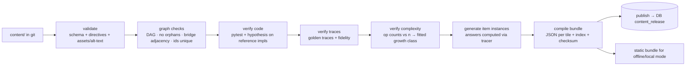

# AlgoVerse — Content Architecture & Schema

> Part of Deliverables 9/10. How curriculum content is authored, validated, verified for correctness, compiled and served, **without touching application code**.

---

## 1. Principles

1. **Content is data.** Lessons, code, explanations, complexity, prerequisites and exercises live in `content/`, never in React components.
2. **Content is code-reviewed.** It lives in git, changes go through pull requests, and CI validates every change.
3. **Content is verified.** Every reference implementation is executed against tests and property-based checks, and complexity claims are checked empirically.
4. **Content is versioned.** A *content release* is an immutable compiled bundle with a version and checksum. Learner progress references stable concept IDs, not file paths.
5. **Widgets are registered, not embedded.** Markdown directives (`:::trace-player`) reference engine widgets by name. Unknown directives fail validation.

## 2. Directory layout

```text
content/
├── curriculum.yaml                 # tiers, ordering hints, global settings
├── tiles/
│   └── b1-1-first-algorithms/
│       ├── tile.yaml               # id, kind, position, integrates, mastery_challenge
│       └── concepts/
│           └── binary-search/
│               ├── concept.yaml    # metadata, prerequisites, complexity, maturity, references
│               ├── lesson.md       # sections A–L with directives
│               ├── code/
│               │   ├── binary_search.py          # reference implementation(s)
│               │   └── binary_search_recursive.py
│               ├── tests/
│               │   └── test_binary_search.py     # pytest + hypothesis
│               ├── viz/
│               │   └── array-search.yaml         # visualization spec (bindings)
│               ├── inputs.yaml                   # preset inputs for experiments
│               ├── items.yaml                    # assessment items & item templates
│               ├── misconceptions.yaml
│               └── assets/                       # svg illustrations (with alt text)
├── problems/<problem-id>/problem.yaml (+ solution.py, tests)
├── projects/<project-id>/project.yaml (+ milestones, starter code)
├── badges.yaml
├── glossary.yaml
└── references.yaml                 # bibliography registry (books, papers, docs)
```

## 3. Schemas (abridged; full definitions as Pydantic models in `packages/content-tools/schema/`)

### 3.1 `concept.yaml`

```yaml
id: first-algorithms.binary-search          # stable, never reused
title: Binary Search
summary: Find an item in a sorted array by repeatedly halving the search space.
tile: first-algorithms
module: searching
sequence: 2                                 # ordering hint inside the tile
core: true                                  # ★ counts toward tile completion
difficulty: 2                               # 1–5
estimated_minutes: 20
maturity: E                                 # E | R | X
kind: algorithm                             # concept | algorithm | data-structure | technique | system
threads: [python, complexity, proof, real-world]
knowledge_components:                       # fine-grained skills used by the adaptive engine
  - bs.halving-invariant
  - bs.mid-computation
  - bs.bound-updates
  - bs.termination
prerequisites:
  requires: [first-algorithms.linear-search, data-and-complexity.logarithms, programming-logic.while-loops]
  recommends: [data-and-complexity.indexing-and-address-arithmetic]
related: [first-algorithms.linear-search]
applies_to: [databases.b-plus-tree-index]
algorithm:                                  # present when kind = algorithm
  deterministic: true
  in_place: true
  stable: null                              # n/a for search
  input_assumptions: ["arr is sorted ascending", "elements are mutually comparable"]
  complexity:
    time:  { best: "O(1)", average: "O(log n)", worst: "O(log n)" }
    space: { auxiliary: "O(1)", note: "O(log n) for the recursive version (call stack)" }
    why: "Each iteration halves the search space hi - lo + 1; at most ⌊log2 n⌋ + 1 iterations."
  verify_complexity:                        # empirical check in CI
    entry: binary_search
    generator: inputs.sorted_random_with_absent_target
    measure: comparisons
    sizes: [16, 64, 256, 1024, 4096, 16384]
    expect: log                             # constant | log | linear | nlogn | quadratic | cubic | exponential
references: [clrs-4e-ch2, knuth-taocp-v3-6.2.1, python-docs-bisect]
review_by: null                             # required for maturity R/X (date)
```

### 3.2 Visualization spec (`viz/*.yaml`)

The spec **binds program state to visual views**. It never scripts the animation (see [VISUALIZATION_ENGINE §5](VISUALIZATION_ENGINE.md#5-view-specs-binding-program-state-to-visuals)).

```yaml
id: array-search
views:
  - type: array
    source: arr                     # a variable in the traced frame
    frame: binary_search            # which function's frame (default: innermost user frame)
    pointers: { lo: lo, mid: mid, hi: hi }
    regions:
      - { name: search-space, from: lo, to: hi, style: active }
      - { name: discarded, outside: [lo, hi], style: muted }
inspector:
  watch: [lo, hi, mid, target, "arr[mid]"]
  derived:
    - { name: "search space size", expr: "hi - lo + 1" }   # evaluated on snapshots, not in user code
call_stack: true
narration: templates/search.yaml    # optional overrides of default op narration
granularity_default: line
```

### 3.3 Items (`items.yaml`) — static items and generated item families

```yaml
items:
  - id: bs-why-sorted
    type: explain-by-reasons
    kcs: [bs.halving-invariant]
    difficulty: 1
    prompt: Why does binary search require a sorted array?
    reasons:
      - { text: "Comparing with arr[mid] tells us which half cannot contain the target", correct: true }
      - { text: "Sorted arrays use less memory", correct: false, misconception: bs.sorted-memory }
      - { text: "Python's // operator only works on sorted lists", correct: false }

templates:                                  # parametrized families → effectively infinite practice
  - id: bs-predict-next-mid
    type: predict-next-step
    kcs: [bs.mid-computation, bs.bound-updates]
    difficulty: { from: 2, to: 3 }
    generator:
      input: inputs.sorted_random(n=range(7, 16), present=0.7)
      run: binary_search                     # executed with the tracer to compute the answer
      pick_step: { op: compare, nth: random(2, 3) }
    ask: "Which index will `mid` be at the next comparison?"
    answer_from: next(op=compare).vars.mid   # extracted from the trace — always correct
    distractors:
      - { from: "mid_if(lo = mid)", misconception: bs.bound-update }
      - { from: "mid_if(round_up)", misconception: bs.mid-rounding }
```

Template instances are generated **server-side at publish time** (a pool of N instances per template, answers precomputed with the tracer) and on demand for practice in the browser. Server-graded checkpoints only use server-held instances, so answers are never shipped to the client before an attempt.

### 3.4 Problems (`problem.yaml`)

```yaml
id: two-sum-sorted
title: Pair With Target Sum (sorted)
difficulty: 2
tags: { concepts: [two-pointers], structures: [array], paradigms: [two-pointers], patterns: [two-pointers], applications: [finance-reconciliation] }
statement: problem.md
io: { input: "nums: list[int] (sorted), target: int", output: "tuple[int, int] | None" }
constraints: ["2 <= len(nums) <= 10^5", "-10^9 <= nums[i] <= 10^9"]
examples: [{ in: { nums: [1, 3, 4, 6, 9], target: 10 }, out: [1, 4] }]
hints: [hint1.md, hint2.md, hint3.md]       # progressive
approaches:
  - { name: brute-force, file: brute.py, time: "O(n^2)", space: "O(1)" }
  - { name: two-pointers, file: two_pointers.py, time: "O(n)", space: "O(1)", optimal: true }
  - { name: hash-set, file: hashing.py, time: "O(n)", space: "O(n)", note: "Doesn't use sortedness" }
tests: { public: tests/public.yaml, hidden: tests/hidden.yaml, edge_cases: [empty-pair, negatives, duplicates] }
reveal_policy: after_attempt                 # after_attempt | after_all_hints | always
```

## 4. Build pipeline (`content-tools`)



| Command | Purpose |
|---|---|
| `content-tools validate` | Schema, references, directives, asset alt-text, maturity/review dates |
| `content-tools graph [--check]` | Graph integrity. `--dot` exports the graph for review |
| `content-tools test` | Runs reference implementations + tests (CPython **and** Pyodide via Node) |
| `content-tools verify-complexity` | Measures op counts across sizes, fits growth class (log-log slope + model comparison), fails if it disagrees with `expect` |
| `content-tools build` | Compiles the bundle |
| `content-tools publish --env local` | Loads a release into the database (idempotent, versioned) |
| `content-tools preview <concept>` | Opens the lesson in the app against the working copy |

**Empirical complexity verification (method).** Run the algorithm on generated inputs at increasing sizes, counting the declared operation (comparisons, element reads/writes, loop iterations) through the tracer's counters. Fit candidate models (`c`, `c·log n`, `c·n`, `c·n log n`, `c·n²`, …) by least squares on normalized data and pick the best by residual. CI fails if the best model differs from `expect` for the declared case (best/worst inputs use dedicated generators). This catches mistakes such as an accidentally quadratic "linear" implementation.

## 5. Versioning & migration of content

- **Concept IDs are permanent.** Renames use `aliases: [old-id]`. Deletions use `deprecated: true` + `replaced_by`.
- Each publish creates `content_release(version, git_sha, checksum)`. Learners' progress keeps working across releases because it references IDs.
- When a concept's checkpoint changes materially (`assessment_version` bump), existing mastery is preserved, but the next review uses the new items.
- For maturity `R`/`X` content, `review_by` dates are required. CI warns 30 days before expiry and fails after it, which forces periodic re-validation of fast-moving fields.

## 6. References & accuracy registry

`references.yaml` holds citable sources (textbooks such as CLRS, Sedgewick, Skiena, Kleinberg–Tardos, Knuth; official docs such as Python and PostgreSQL; standards such as NIST FIPS 203/204/205; original papers such as Malkov & Yashunin on HNSW and Ongaro & Ousterhout on Raft). Every concept of maturity R/X must cite at least one primary source. Algorithm properties (stability, determinism, complexity) must be backed by a reference **or** an empirical check.
