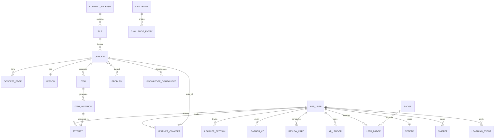

# AlgoVerse — Database Schema & API Architecture

> Deliverable 10. Relational schema (SQLite ⇄ PostgreSQL portable) and the REST API (`/api/v1`).

---

## 1. Data ownership

| Data | Source of truth | Stored where |
|---|---|---|
| Curriculum, lessons, items, problems, projects | `content/` in git | Compiled into `content_*` tables per release (read-only at runtime) |
| Learner progress, attempts, mastery, reviews | API | `learner_*`, `attempt`, `review_card` tables |
| Gamification (XP, badges, streaks) | API | `xp_ledger`, `user_badge`, `streak`, `challenge_*` |
| Playground snippets | Learner | `snippet` (cloud) or IndexedDB (local) |
| Execution traces | Ephemeral | Browser memory; optionally saved as a share/bookmark (`saved_trace`, compressed) |

**IDs:** UUIDv7 (time-ordered) for runtime rows. Content rows use their stable slug IDs. **Timestamps:** UTC. **JSON:** a `JSON` type with a JSONB variant on PostgreSQL.

---

## 2. Entity-relationship overview



---

## 3. Tables

### 3.1 Content (written only by `content-tools publish`)

| Table | Key columns | Notes |
|---|---|---|
| `content_release` | `id`, `version` (semver), `git_sha`, `checksum`, `published_at`, `is_active` | Exactly one active release |
| `tile` | `id` (slug), `release_id`, `kind` (`domain`/`bridge`), `row`, `col`, `title`, `tagline`, `maturity`, `mastery_challenge_id`, `integrates` (JSON) | Unique `(release_id, row, col)` |
| `concept` | `id` (slug), `release_id`, `tile_id`, `module`, `title`, `summary`, `kind`, `core`, `difficulty`, `est_minutes`, `maturity`, `sequence`, `threads` (JSON), `algorithm` (JSON: complexity, flags), `review_by` | Index `(tile_id, sequence)` |
| `concept_edge` | `release_id`, `from_id`, `to_id`, `type` (`requires`/`recommends`/`related`/`applies_to`/`generalizes`) | PK `(release_id, from_id, to_id, type)` |
| `knowledge_component` | `id`, `concept_id`, `title` | Skills for the adaptive engine |
| `lesson` | `concept_id`, `release_id`, `body` (JSON compiled blocks), `assets` (JSON) | Served whole, cached with ETag |
| `item` | `id`, `concept_id`, `type`, `kcs` (JSON), `difficulty`, `elo_b` (calibrated), `prompt` (JSON, public), `answer` (JSON, **server-only**), `misconceptions` (JSON), `is_template` | |
| `item_instance` | `id`, `item_id`, `params` (JSON), `prompt` (JSON), `answer` (JSON, server-only), `seed` | Pre-generated pools for server-graded checkpoints |
| `misconception` | `id`, `concept_id`, `title`, `remediation` (JSON: activity refs) | |
| `problem` | `id`, `title`, `difficulty`, `tags` (JSON), `statement` (JSON), `hints` (JSON), `approaches` (JSON), `public_tests` (JSON), `hidden_tests` (JSON, server-only), `reveal_policy` | |
| `project` | `id`, `title`, `milestones` (JSON), `concepts` (JSON) | |
| `badge` | `id`, `title`, `description`, `icon`, `criteria` (JSON rule), `tier` | |

### 3.2 Learners & progress

| Table | Key columns | Notes |
|---|---|---|
| `app_user` | `id`, `email` (unique, nullable in local mode), `display_name`, `password_hash`, `role`, `settings` (JSON), `created_at`, `deleted_at` | |
| `session` | `id` (random 256-bit, hashed at rest), `user_id`, `created_at`, `expires_at`, `ip_hash`, `user_agent` | |
| `learner_concept` | `user_id`, `concept_id`, `state` (`locked…review_due`), `mastery` (0–1), `evidence_count`, `first_seen_at`, `proficient_at`, `mastered_at`, `last_activity_at` | PK `(user_id, concept_id)` |
| `learner_section` | `user_id`, `concept_id`, `section` (A–L), `completed_at`, `data` (JSON, e.g. predictions made) | Resume position |
| `learner_kc` | `user_id`, `kc_id`, `theta` (ability), `n` (evidence), `updated_at` | Elo-style ability |
| `attempt` | `id`, `user_id`, `item_id`, `item_instance_id`, `context` (`lesson`/`checkpoint`/`review`/`challenge`/`problem`), `response` (JSON), `correct`, `score` (0–1), `hints_used`, `duration_ms`, `misconception_id`, `client_attempt_id` (idempotency), `created_at` | Unique `(user_id, client_attempt_id)` |
| `review_card` | `user_id`, `concept_id`, FSRS fields: `stability`, `difficulty`, `due_at`, `reps`, `lapses`, `state`, `last_review_at` | Index `(user_id, due_at)` |
| `problem_submission` | `id`, `user_id`, `problem_id`, `code`, `status`, `passed`, `total`, `counters` (JSON), `graded_by` (`client`/`judge`), `created_at` | |
| `snippet` | `id`, `user_id`, `title`, `code`, `inputs` (JSON), `updated_at` | |
| `saved_trace` | `id`, `user_id`, `title`, `trace_gz` (blob), `created_at` | Time-machine bookmarks/shares |

### 3.3 Gamification

| Table | Key columns | Notes |
|---|---|---|
| `xp_ledger` | `id`, `user_id`, `amount`, `reason` (enum), `source_type`, `source_id`, `idempotency_key` (unique), `created_at` | **Append-only.** Totals = SUM (cached in `user_stats`) |
| `user_stats` | `user_id`, `xp_total`, `level`, `concepts_mastered`, `updated_at` | Projection, rebuildable from the ledger |
| `user_badge` | `user_id`, `badge_id`, `awarded_at`, `context` (JSON) | PK `(user_id, badge_id)` |
| `streak` | `user_id`, `current`, `longest`, `last_active_date` (learner's local date), `freezes_available`, `timezone` | |
| `daily_goal` | `user_id`, `date`, `target_xp`, `earned_xp`, `met_at` | |
| `challenge` | `id`, `kind` (`daily`/`weekly`/`debugging`/`optimization`/`comparison`/`build`), `starts_at`, `ends_at`, `payload` (JSON) | |
| `challenge_entry` | `challenge_id`, `user_id`, `score`, `submitted_at`, `graded_by` | |

### 3.4 Analytics & operations

| Table | Notes |
|---|---|
| `learning_event` | `id`, `user_id`, `type`, `payload` (JSON), `created_at`. Pseudonymous, retained 180 days. Feeds item calibration and content-quality dashboards (e.g. "step where most learners mispredict") |
| `execution_job` (Phase 8) | `id`, `user_id`, `kind`, `status`, `request` (JSON), `result` (JSON), `created_at`, `claimed_at`, `finished_at` |

---

## 4. API design

**Conventions:** REST over JSON at `/api/v1`. Errors use **RFC 9457 Problem Details**. Cursor pagination (`?cursor=&limit=`). `ETag` + `Cache-Control` on content. Mutations accept an `Idempotency-Key` header (stored for 24 h). A typed TS client is generated from OpenAPI (`openapi-typescript`). Session cookie + `X-CSRF-Token` on mutating requests.

### 4.1 Endpoints

| Area | Method & path | Purpose |
|---|---|---|
| **Health** | `GET /healthz`, `GET /readyz` | Liveness/readiness |
| **Auth** | `POST /auth/register` · `POST /auth/login` · `POST /auth/logout` · `GET /auth/csrf` | Cloud mode; local mode auto-session |
| **Me** | `GET /me` · `PATCH /me` · `GET /me/export` · `DELETE /me` | Profile, preferences, data export, deletion |
| **Content** | `GET /content/release` | Active release version (clients cache by it) |
| | `GET /content/graph` | Tiles + concepts (metadata) + edges for the universe/explorer (no lesson bodies) |
| | `GET /content/tiles/{tileId}` | Tile detail with modules & concepts |
| | `GET /content/concepts/{conceptId}` | Concept metadata, complexity, connections |
| | `GET /content/lessons/{conceptId}` | Compiled lesson blocks (public parts only) |
| | `GET /content/search?q=` | Library search (concepts, glossary, problems) |
| | `GET /content/explorer/path?to={conceptId}` | Prerequisite subgraph + shortest learning path given learner state |
| **Universe** | `GET /universe` | Learner-specific tile & concept states for the map |
| **Progress** | `POST /progress/events` | Batched learning events (section viewed/completed, trace played, prediction made). Idempotent |
| | `GET /progress/summary` | Totals, per-tile progress, recent concepts |
| | `GET /progress/concepts/{conceptId}` | State, mastery, KC abilities, history |
| **Assessment** | `GET /assessment/concepts/{conceptId}/practice?n=` | Practice items (client-gradable, answers included for instant feedback) |
| | `POST /assessment/checkpoints/{conceptId}/start` | Draws a server-graded instance set → `checkpointId` |
| | `POST /assessment/attempts` | Submit an attempt (server grades when required) → result, feedback, misconception, follow-up |
| | `POST /assessment/checkpoints/{checkpointId}/finish` | Mastery decision |
| **Review** | `GET /reviews/due` · `POST /reviews/{conceptId}` | FSRS queue & review outcome |
| **Recommend** | `GET /recommendations/next` | Next-best activities with reasons ("because you missed `bs.mid-rounding`") |
| **Gamification** | `GET /gamification/profile` | XP, level, badges, streak, goal |
| | `GET /gamification/challenges/current` · `POST /gamification/challenges/{id}/entries` | Daily/weekly challenges |
| **Problems** | `GET /problems?concept=&pattern=&difficulty=&cursor=` · `GET /problems/{id}` | Catalog & detail (solutions withheld per policy) |
| | `POST /problems/{id}/submissions` · `GET /problems/{id}/hints/{n}` · `GET /problems/{id}/solution` | Submit (client results + optional judge), progressive hints, gated solution |
| **Playground** | `GET/POST/PATCH/DELETE /snippets[/{id}]` | Saved code |
| **Traces** | `POST /traces` · `GET /traces/{id}` | Save/share a Time Machine trace (compressed) |
| **Execution** (Phase 8) | `POST /executions` · `GET /executions/{id}` · `WS /executions/{id}/stream` | Server judge jobs |
| **Admin** (author/admin) | `POST /admin/content/releases/{id}/activate` · `GET /admin/analytics/items` | Release activation, item difficulty/quality stats |

### 4.2 Example: submitting an attempt

```http
POST /api/v1/assessment/attempts
Idempotency-Key: 0193b6f2-…
X-CSRF-Token: …

{ "itemInstanceId": "ii_8f2…", "context": "checkpoint", "checkpointId": "cp_31a…",
  "response": { "choice": 3 }, "hintsUsed": 0, "durationMs": 14210, "clientAttemptId": "ca_77…" }
```

```json
{ "correct": false, "score": 0,
  "feedback": { "explanation": "mid = (lo + hi) // 2 = (5 + 8) // 2 = 6, not 7: // rounds down.",
                "misconception": { "id": "bs.mid-rounding", "title": "Rounding mid up" },
                "showTraceStep": 14 },
  "followUp": { "kind": "item", "itemId": "int-div-refresher-02" },
  "xpAwarded": 0,
  "masteryDelta": { "kc": "bs.mid-computation", "theta": -0.12 } }
```

### 4.3 Where grading happens

| Context | Grader | Why |
|---|---|---|
| In-lesson checks, practice, predictions | **Client** (answers shipped with practice items) | Instant feedback; low stakes. XP from client-graded items is capped per concept per day |
| Mastery checkpoints, reviews | **Server** (answers never leave the server before submission) | Mastery integrity |
| Code exercises & problems | Client runs tests in Pyodide and reports results. Hidden tests are graded server-side by running submitted code in the Judge (Phase 8). Until then (local single-user MVP), hidden tests are delivered only at submission time and run client-side. Integrity is not a goal in local mode, where learners could only cheat themselves | Practical MVP with a clear upgrade path |

### 4.4 WebSocket usage
Not needed in MVP. Introduced in Phase 8 only for streaming Judge execution output and (later) live presenter mode.
