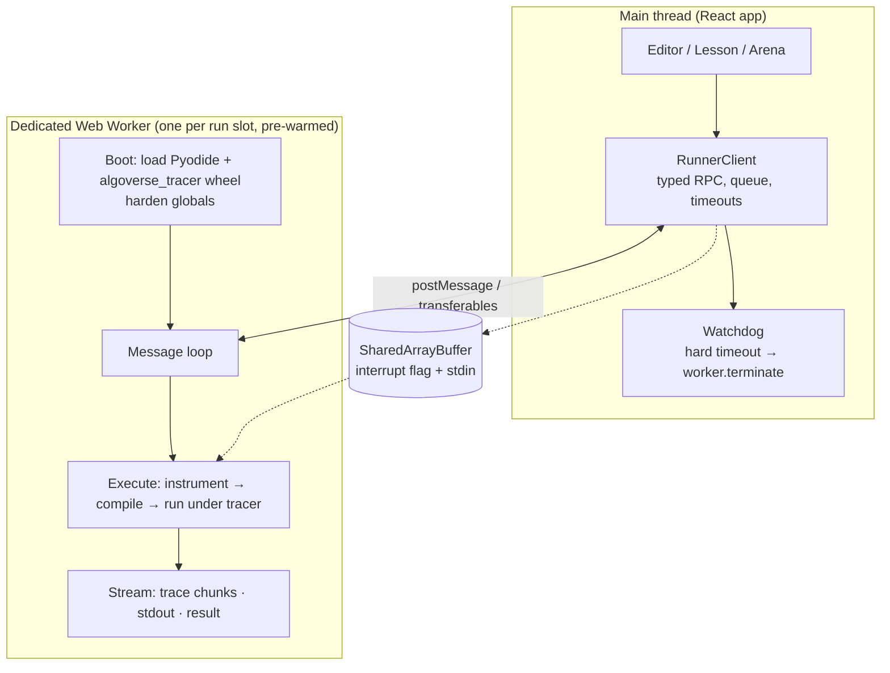
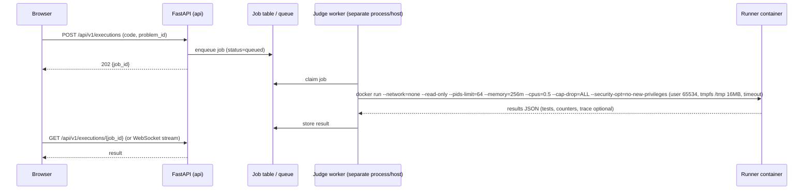

# AlgoVerse — Python Execution, Tracing & Debugging Architecture

> Deliverable 7. How learner and reference Python code runs **safely**, how execution is **instrumented** (no text matching), and how the Playground, debugger and comparisons are built on top of it.

---

## 1. Decision summary

| Question | Decision | Why |
|---|---|---|
| Where does learner code run? | **In the learner's browser: Pyodide (CPython compiled to WebAssembly) inside a dedicated Web Worker** | Strong isolation (browser sandbox + no DOM + no server exposure); zero server cost; works offline/local; instant re-runs; scales to any number of learners |
| What about authoritative grading / heavy jobs? | **Server "Judge" service** (Phase 8/10): disposable, locked-down containers running the *same* tracer | Anti-cheat for leaderboards; native CPython timing; jobs too heavy for browsers |
| How is execution observed? | **AST instrumentation + `sys.settrace`** in one pure-Python package `algoverse_tracer`, emitting trace schema v1 | Precise semantic events (comparisons, subscripts, method calls) with exact source spans; no source-text matching |
| How are visuals synced? | Visuals consume the **trace** (data), not the running interpreter | Determinism, time travel, decoupling |

See [ADR-003, ADR-004](DECISIONS.md).

---

## 2. Runtime architecture



- **Worker pool:** 1 pre-warmed worker (2 on machines with ≥ 8 cores) so "Run" starts instantly. After a hard kill, a replacement boots in the background.
- **Pyodide loading:** lazily on first need (lessons prefetch it during section A). Cached by a Service Worker. Version pinned and self-hosted (no CDN dependency at runtime).
- **Cross-origin isolation:** the app is served with `Cross-Origin-Opener-Policy: same-origin` and `Cross-Origin-Embedder-Policy: require-corp`, which enables `SharedArrayBuffer`. That allows (a) **soft interrupts** via Pyodide's interrupt buffer (`KeyboardInterrupt` inside Python, so the worker survives) and (b) **synchronous `input()`** via `Atomics.wait`.
- **Packages:** stdlib only by default. Lessons may allow-list packages (e.g. `numpy` in Tier 6), which are loaded from the self-hosted Pyodide package index. Learner code cannot install packages (`micropip` blocked).

### 2.1 Worker RPC protocol (typed, versioned)

```ts
type ToWorker =
  | { type: "init"; protocol: 1; packages?: string[] }
  | { type: "run"; runId: string; mode: "run" | "trace" | "test" | "measure";
      files: { name: string; text: string }[]; entry?: { func: string; args: unknown[] };
      stdin?: string; seed: number; limits: Limits; vizHints?: { maxHeapItems: number } }
  | { type: "cancel"; runId: string };

type FromWorker =
  | { type: "ready"; pythonVersion: string; pyodideVersion: string }
  | { type: "stdout" | "stderr"; runId: string; text: string }
  | { type: "trace-chunk"; runId: string; events: ArrayBuffer /* encoded */; final: boolean }
  | { type: "result"; runId: string; status: "completed" | "error" | "step_limit" | "timeout" | "cancelled";
      value?: unknown; error?: FriendlyError; counters: Counters; timing: { wallMs: number }; peakMemKb?: number }
  | { type: "test-report"; runId: string; cases: TestCaseResult[] };

interface Limits { maxSteps: number; softTimeoutMs: number; hardTimeoutMs: number; maxOutputBytes: number;
                   maxRecursionDepth: number; maxTraceBytes: number }
```

---

## 3. The tracer (`packages/tracer`, Python)

One package, three hosts: Pyodide (browser), CPython (content CI and tests), and the Judge container (server).

### 3.1 Stage 1 — AST instrumentation (precise semantic events)

`instrument(source) → code object` parses the learner's source with `ast`, transforms it, and compiles it with the **original line/column positions preserved** (`ast.copy_location`). Tracebacks and highlights therefore always point at the learner's own code.

| Construct | Rewritten to | Emits |
|---|---|---|
| `a < b` (single comparison) | `__av.cmp("<", a, b, node_id)` | `compare` with values, result and **origins** |
| `a < b < c` (chained) | evaluated left-to-right with walrus temporaries, preserving single evaluation and short-circuiting | one `compare` per link |
| `x[k]` (load) | `__av.getitem(x, k, node_id)` | `read` (records origin for later `write`) |
| `x[k] = v` / `x[k] += v` | `__av.setitem(x, k, v, node_id)` (aug-assign: read + write) | `write` with `old`, `value`, `valueOrigin` |
| `a[i], a[j] = a[j], a[i]` | RHS reads, then ordered setitems in one statement group | two `write`s → analyzer coalesces to `swap` |
| `del x[k]` | `__av.delitem(...)` | `delete` |
| `obj.method(args)` where method ∈ allow-list (`append, pop, insert, remove, extend, popleft, appendleft, add, discard, update, setdefault, get, sort, reverse`) | `__av.callmethod(obj, "append", args, node_id)` | `method` |
| `heapq.heappush/heappop/heapify`, `bisect.*` | wrapped | `method` (semantic: heap/bisect ops) |
| `node.next = other` (attribute store on instances) | `__av.setattr(node, "next", other, node_id)` | `attr_write` |

- **Origins** come from a per-statement "last-read" registry: when `__av.getitem(arr, j)` returns a value, the tracer remembers `(arr, j)` for that value object *within the current statement*. If the same object is then written into a container, the write carries `valueOrigin`. This makes swaps and shifts detectable without guessing.
- `node_id` indexes a side table of source spans (line, col, end line, end col) for exact sub-expression highlighting.
- **Semantics are preserved.** Wrappers call the real operators (`operator.lt`, `type(x).__getitem__`, etc.) and return their results unchanged, including custom `__lt__`/`__getitem__` and exceptions. A property-based test suite runs random programs instrumented vs. uninstrumented and asserts identical outputs.
- **Fallback:** if instrumentation of some construct fails (unusual syntax), that node is left uninstrumented and a `degraded` flag is recorded. Line-level tracing and state snapshots still work.

### 3.2 Stage 2 — line/call/return tracing

- `sys.settrace` with a frame filter: only frames whose `co_filename` is a learner/reference virtual file (`<learner:main.py>`) are traced. Library internals are invisible.
- On `call`: push frame (`frameId`, function name, argument values). On `line`: emit `line` with a **delta** of changed locals (compared with the previous snapshot of that frame). On `return`: emit the return value and pop. On `exception`: capture type, message and traceback spans.
- Abstraction `TraceBackend` with a `settrace` implementation first. A `sys.monitoring` (PEP 669, Python ≥ 3.12) backend is planned for lower overhead in long runs (decided by benchmark in Phase 6).

### 3.3 Serializer (state → schema values)

- Primitives inline. Compound objects go into the heap with stable ids (see [VISUALIZATION_ENGINE §3.1](VISUALIZATION_ENGINE.md#31-values-and-the-heap)).
- **Heap deltas:** after each event, only containers touched since the last event are re-serialized. The instrumentation knows which containers were written; locals rebinds are found by identity comparison.
- Caps: `maxHeapItems` per container (default 1,000, flagged `truncated`), string length 2,000, recursion-safe (cycles become refs).
- Instances: `__dict__` / `__slots__` fields. Opaque objects show `typeName` + `repr` (truncated).

### 3.4 Counters (for Battle Arena & complexity verification)

Counters are machine-independent: `lines, comparisons, reads, writes, swaps (post-coalescing), calls, maxDepth`, plus allocation count. They are exact and cheap, and they are the **primary** metrics in the Arena. Wall time is secondary and always labelled as a measurement in WebAssembly CPython on this device.

### 3.5 Determinism

- `random` is seeded per run (`seed` in the run request, shown in the UI, and changeable).
- `time.time()`/`datetime.now()` remain real in free mode. Lesson mode can enable a deterministic clock shim.
- Hash randomization: `PYTHONHASHSEED`-equivalent fixed in traced runs, so `set` iteration orders are reproducible across replays.

---

## 4. Modes

| Mode | Purpose | Tracing | Default limits |
|---|---|---|---|
| `run` | Just execute, show output (Playground) | Off (fast) | 10 s, 1 MB output |
| `trace` | Visualize / debug / time-travel | Full | 20k events, 5 s, 8 MB trace |
| `test` | Run against test cases (exercises, problems) | Off (counters on) | per-case 2 s, total 10 s |
| `measure` | Battle Arena, complexity experiments | Counters only | per-size 3 s |

**Educational execution mode** (lessons): reference code + learner inputs, spec-bound visuals, authored narration. **Free-coding mode** (Playground): any code, Auto View, generic narration.

---

## 5. Sandboxing & resource limits (browser)

### 5.1 Threat model

| Threat | Relevance | Mitigation |
|---|---|---|
| Infinite loop / CPU exhaustion | High (common learner bug) | Step limit inside tracer → soft interrupt (`SharedArrayBuffer`) → hard `worker.terminate()` watchdog |
| Memory exhaustion (`[0] * 10**10`) | High | WebAssembly memory ceiling + `tracemalloc` soft limit checked in the trace hook + hard kill on worker OOM. The UI explains "your program tried to use too much memory" |
| Deep recursion | High | `sys.setrecursionlimit` (default 1,000, lesson-configurable up to 3,000 within Pyodide's stack budget). `RecursionError` gets a friendly explanation |
| Output flood | Medium | `maxOutputBytes`, then truncation notice |
| Network access from learner code | Medium | Pyodide's JS bridge is blocked: import hook denies `js`, `pyodide.ffi`, `pyodide.http`, `pyodide_js`, `micropip`. Worker globals `fetch`, `XMLHttpRequest`, `WebSocket`, `importScripts`, `EventSource` deleted before learner code runs. CSP `connect-src 'self'` |
| Filesystem access | Low | Emscripten in-memory FS only (reset per run). No host FS exists in the browser |
| OS access (`os.system`, `subprocess`) | Low | Not functional in WASM. Additionally blocked by the import/attribute deny-list for clear error messages |
| Attacking the AlgoVerse API with the learner's session | Medium | Worker has no network (above). API uses httpOnly cookies + CSRF tokens that the worker never sees |
| Running *someone else's* malicious code | Medium (future sharing) | Shared snippets open in **"untrusted" mode**: executed inside a sandboxed, cross-origin, opaque-origin `<iframe sandbox="allow-scripts">` hosting the worker. Shared code never auto-runs |

> Key insight: in MVP, learners only run code they wrote or chose to load, in their own browser. The sandbox protects the learner's session and machine from mistakes, and protects the platform from abuse. It never has to protect the server, because no learner code reaches it.

### 5.2 Friendly errors
Exceptions are mapped to learner lines and explained, e.g. `IndexError: list index out of range` at `arr[mid]` gives *"`mid` was 9 but `arr` has indices 0–8. Check how `hi` was initialised."* Explanations come from an extensible rule table (exception type + AST context + snapshot values).

---

## 6. Server Judge service (Phase 8 → hardened in Phase 10)

Needed for: server-authoritative grading (leaderboards, weekly challenges), heavy runs, native timing.



- **Never** in the API process. The Judge runs as a separate deployable with access only to the job table and the container runtime.
- Production hardening: gVisor (`runsc`) or Firecracker microVMs. Seccomp default profile. Rootless containers. One container per job, destroyed after use.
- Same `algoverse_tracer` package and same trace schema, so the browser can visualize server traces too.
- Queue: a database-backed job table (`SELECT … FOR UPDATE SKIP LOCKED` on Postgres) to avoid an extra broker initially. Swappable for Redis/RQ if load requires it.

---

## 7. Python Playground (built on the runtime)

| Feature | How |
|---|---|
| Write code | CodeMirror 6 with Python language support, lint (syntax errors via `ast.parse` in the worker on idle), autocomplete for builtins |
| Execute | `run` mode, streaming stdout |
| Modify existing algorithms | "Open in Playground" from any lesson copies the reference code + inputs + spec |
| Change inputs | Inputs panel: JSON-ish literals validated by `ast.literal_eval` in the worker. Generators (random/sorted/reversed/…) |
| Inspect variables / view steps | `trace` mode → visualization + inspector + Time Machine |
| Identify errors | Friendly errors (§5.2), line markers, the failing step in the trace |
| Debug step by step | **Omniscient debugging:** the full trace exists, so the "debugger" navigates it: step over/into/out, breakpoints, conditional breakpoints, watch expressions, reverse step |
| Compare two implementations | Split editor. Both run in `measure` + `trace` mode on the same inputs. Outputs diffed, counters compared, traces scrubbed in lockstep by op index |
| Measure execution time | `measure` mode, repeated runs (median of k), labelled as browser WASM timing |
| Compare memory usage | `tracemalloc` peak where available. Fallback: structural size estimate via `sys.getsizeof` traversal (labelled "estimate"). Feasibility verified in the Phase 3 spike |
| Preloaded examples | Every algorithm concept exposes its reference code as an example |
| Save | Local (IndexedDB) in local mode. Account snippets in cloud mode |

---

## 8. Testing the runtime

| Test | Host | Example |
|---|---|---|
| Instrumentation preserves semantics | CPython (Hypothesis-generated programs) + Pyodide (sample) | Same stdout/return/exception instrumented vs plain |
| Event correctness | CPython | Bubble sort on `[5,1,4]` produces the golden op sequence |
| Span accuracy | CPython | Every `compare` span covers exactly the compare expression |
| Determinism | Both | Same code + seed gives the same trace hash |
| Limits | Pyodide (Playwright) | `while True: pass` stops ≤ soft+hard timeout. `[0]*10**10` gives a memory error with the worker replaced. Recursion 10⁵ gives a friendly RecursionError |
| Sandbox | Pyodide (Playwright) | `import js`, `from pyodide.ffi import …`, `import micropip`, `open('/etc/passwd')`, `__import__('os').system('…')`, `globals()['__builtins__']` tricks → all blocked or harmless. Worker has no `fetch` |
| Performance | Pyodide | 5k-event trace < 1.5 s on the reference laptop profile |
