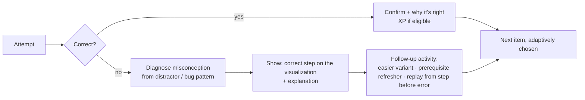
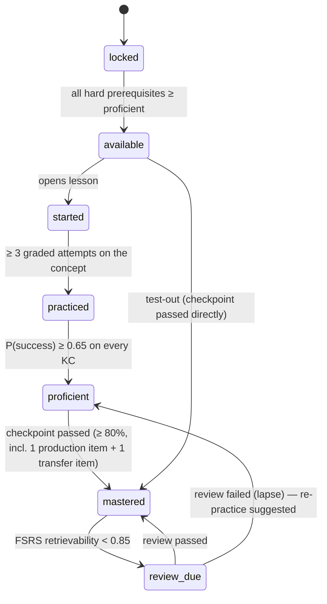

# AlgoVerse — Gamification, Assessment & Adaptive Learning

> Deliverable 11. How AlgoVerse motivates learners **without rewarding clicks**, how understanding is measured, and how the platform adapts.

---

## 1. Design stance

> **Rewards follow evidence of understanding, never exposure.**

| Do | Don't |
|---|---|
| Award XP for correct predictions, solved exercises, passed checkpoints, on-time reviews | Award XP for watching animations, opening lessons, or clicking "next" |
| Make progress visible (pyramid growth, mastery rings) | Use loss-aversion mechanics (losing hearts/lives, punitive streak loss) |
| Celebrate milestones briefly | Interrupt learning with modal celebrations |
| Diminishing returns for repetition | Allow farming XP on the same easy item |
| Encourage hints | Shame hint usage |

---

## 2. Assessment engine

### 2.1 Item types

| Type | Evidence of | Graded by |
|---|---|---|
| `mcq`, `multi-select`, `numeric` | Recognition/recall | Client (practice) / server (checkpoint) |
| `predict-output` | Mental execution | Same |
| `predict-next-step` (on the visualization) | Algorithm understanding | Trace-derived answer |
| `trace-the-variable` | Detailed tracing | Trace-derived |
| `parsons` (arrange lines) | Code structure | Order check + tests |
| `fill-in-code` | Partial production | Tests |
| `find-the-bug` | Debugging | Line match + fix tests |
| `code-with-tests` | Full production | Tests (Pyodide; Judge later) |
| `drag-arrange` (perform the algorithm by hand) | Procedural fluency | Each move checked against the trace's next op |
| `build-structure` | Structural understanding | Invariants on the built heap model |
| `complexity-pick` | Analysis | Authored + empirical |
| `choose-the-algorithm` | Transfer / judgement | Authored rubric |
| `explain-by-reasons` | Conceptual explanation | Select valid reasons, reject plausible-but-wrong ones |

**Trace-generated item families** produce unlimited, always-correct variations (new inputs, same skill). They are the backbone of practice and spaced review, and they prevent memorizing answers.

### 2.2 Feedback loop



---

## 3. Mastery model

### 3.1 Knowledge components (KCs)
Each concept is decomposed into 2–6 KCs (e.g. binary search: halving invariant, mid computation, bound updates, termination). Items are tagged with the KCs they exercise.

### 3.2 Ability estimation (Elo-style, per learner × KC)

```text
expected = 1 / (1 + exp(-(θ_kc − b_item)))        # probability of success
outcome  = score × hint_factor                    # hint_factor: 1.0, 0.75 (1 hint), 0.5 (2+), 0 if solution viewed
θ_kc    ← θ_kc + K(n) × (outcome − expected)     # K(n) = 0.4 / (1 + 0.05·n), shrinking with evidence count n
b_item  ← b_item − k_item × (outcome − expected) # item difficulty calibrated across learners (cloud mode)
```

Why Elo instead of full Bayesian Knowledge Tracing or IRT: it works from the first attempt with no training data, is cheap and transparent, and is easy to explain in the UI. BKT/IRT can replace it later behind the same `mastery` service interface once enough data exists.

### 3.3 Mastery state machine



- **Watching never changes state** beyond `started`.
- **Unlocking uses `proficient`**, not `mastered`. Learners can keep moving while mastery consolidates, which avoids frustrating gates.
- Tile completion uses ★ core concepts ≥ proficient. Tile mastery requires all core concepts mastered + the tile challenge (see [PYRAMID_MODEL §5](PYRAMID_MODEL.md#5-how-the-pyramid-grows-state--reveal-rules)).

### 3.4 Spaced repetition (FSRS)
- A review card is created per concept when it reaches `mastered`.
- A review session draws 2–3 **fresh generated instances** across the concept's KCs (not the same questions again).
- Outcome maps to FSRS ratings: all correct, no hints → *Good*; fast and all correct → *Easy*; some errors → *Hard*; mostly wrong → *Again* (lapse).
- The daily review queue is capped (default 10 concepts) and interleaved, so related concepts are mixed rather than blocked.

---

## 4. Adaptive engine

### 4.1 What it detects

| Signal | Detection |
|---|---|
| Understood concepts | KC abilities high, checkpoint passed, reviews passing |
| Repeated errors | Same misconception ID ≥ 2 times in 7 days |
| Topics needing revision | FSRS due / retrievability low |
| Missing prerequisite knowledge | Errors on KCs whose prerequisite concept has low ability or was never practiced (prerequisite edges carry KC mappings) |
| Ready for advanced challenges | All KCs θ well above target + fast correct responses → offer the *advanced* exercise tier and challenges |

### 4.2 Next-best-activity recommender (transparent scoring)

```text
score(activity) = w1·due_review + w2·remediation_need + w3·readiness + w4·unlock_value
                + w5·goal_alignment − w6·recency_penalty − w7·overload_penalty
```

- `readiness`: concept available + prerequisites strong.
- `unlock_value`: number of concepts it unlocks (from the graph).
- `remediation_need`: active misconception linked to the activity.
- Every recommendation carries a **human-readable reason** shown in the UI.
- Default weights favour finishing started work and due reviews. They live in config, so they can be tuned without code changes.

---

## 5. XP, levels and progression

### 5.1 XP rules

| Source | XP | Limits |
|---|---|---|
| Correct prediction during a trace (first try) | 5 | ≤ 10 per lesson |
| Practice item correct (first try) | 5–20 by difficulty | Diminishing: same item family × 0.5 after 3 per day |
| Exercise (beginner / intermediate / advanced) | 15 / 30 / 50 | Once per item |
| Mastery checkpoint passed | 100 (+50 if no hints) | Once per concept (+ re-certification after lapse: 30) |
| Review completed on time | 15 | Per due review |
| Problem solved | 20–150 by difficulty | Once per problem; −30% if solution viewed first (then 0) |
| Tile completed / mastered | 200 / 400 | Once |
| Daily / weekly challenge | 40–200 | Per challenge |
| Viewing content, playing animations | **0** | — |

All XP flows through the append-only `xp_ledger` with idempotency keys (`attempt:<id>`, `checkpoint:<concept>:<n>`). Double awards are impossible, and totals are rebuildable.

### 5.2 Levels
Cumulative XP for level L: `XP(L) = 50 · L · (L + 1)`, so Lv1 = 100, Lv2 = 300, Lv5 = 1,500, Lv10 = 5,500, Lv20 = 21,000. Early levels come quickly (onboarding motivation), and later levels reflect sustained mastery. Level titles follow the journey: *Novice → Apprentice → Tracer → Builder → Analyst → Architect → Explorer → Pioneer*.

### 5.3 Streaks & daily goals
- Daily goal (default 30 XP, learner-adjustable 10–150). The streak counts days where the goal was met.
- **Streak freeze:** earned every 7 streak days (max 2 banked), auto-applied on a missed day.
- Days are computed in the learner's timezone. Rollover runs as a scheduled job.

### 5.4 Badges (seed catalogue)

| Category | Examples |
|---|---|
| Milestone | *First Trace* · *Pyramid I Complete* · *Pyramid II Builder* · *Into the Graphs* · *Systems Thinker* |
| Skill (concept/tile mastery) | *Halving Hero* (binary search) · *Pointer Wrangler* (linked lists) · *Heap Keeper* · *Graph Walker* · *DP Strategist* |
| Behaviour | *Predictor* (50 correct predictions) · *Bug Hunter* (10 find-the-bug) · *Time Traveler* (Time Machine queries) · *Arena Analyst* (explain 5 battle outcomes) · *Comeback* (fixed a recurring misconception) |
| Consistency | *7-Day Streak* · *30-Day Streak* · *Review Ritual* (20 on-time reviews) |

Badge criteria are **declarative rules** in `content/badges.yaml`, evaluated by the gamification module on domain events. New badges need no code changes.

```yaml
- id: predictor
  title: Predictor
  criteria: { event: PredictionGraded, where: { correct: true, first_try: true }, count: 50 }
```

---

## 6. Challenges

| Challenge | Mechanic | Evaluated by |
|---|---|---|
| Daily algorithm challenge | One generated item set mixing due/near-due concepts | Assessment engine |
| Weekly problem-solving challenge | 3 problems of rising difficulty around a theme | Tests (Judge in cloud mode for ranking) |
| Debugging challenge | Code with planted bugs (mutations of reference implementations) | Tests + bug-line match |
| Code optimization challenge | Make it pass with ≤ N comparisons (counters, not wall-clock, so it is fair across devices) | Counters from tracer |
| Algorithm comparison challenge | Predict the winner on a dataset, then explain why | Arena run + reasons |
| Build-it-yourself challenge | Construct a structure satisfying invariants (e.g. a valid AVL after inserts) | Invariant checker |

Leaderboards are **opt-in**, cloud-only, and weekly-scoped, comparing learners against peers at a similar level. The default view compares the learner with their own past self.

---

## 7. Learning analytics (privacy-preserving)

Events (`learning_event`): `section_viewed`, `section_completed`, `trace_played`, `prediction_made`, `attempt_graded`, `hint_used`, `review_done`, `misconception_detected`, `concept_state_changed`. They power:
- Learner-facing: progress history, misconception history, time spent per tile.
- Content-facing (aggregated, cloud): item difficulty calibration, distractor effectiveness, *trace steps with the highest misprediction rate* (to improve narration), drop-off sections.

No third-party analytics. Local mode keeps everything on the learner's machine.
