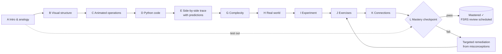

# AlgoVerse — Learning Experience & Lesson Design

> Deliverable 5. The reusable lesson engine, the 12-section template, the pedagogy behind it, and a fully worked example (Binary Search).

---

## 1. Pedagogical principles (what every design decision is tested against)

| Principle | Evidence-based practice | How AlgoVerse applies it |
|---|---|---|
| **Predict → Observe → Explain** | Prediction before observation increases learning and exposes misconceptions | Before key animation steps the player pauses with *"What happens next?"* The answer is checked against the real trace |
| **Dual coding** | Words + visuals beat either alone | Every operation has a visual change *and* a one-line narration |
| **Worked → faded → independent** | Worked examples reduce cognitive load for novices | Lesson flow: watch full trace → fill gaps (Parsons, fill-in-code) → write from blank |
| **Use → Modify → Create** | Proven progression for programming | Run the reference → edit inputs/code → implement from scratch |
| **Retrieval practice** | Testing strengthens memory | Short checks inside lessons. Mastery requires recall, not recognition only |
| **Spaced repetition** | Spacing beats massing | FSRS schedules concept reviews (see [GAMIFICATION](GAMIFICATION.md)) |
| **Interleaving** | Mixed practice improves discrimination | Reviews and the Pattern trainer mix concepts ("is this a sliding window or two pointers?") |
| **Cognitive load management** | Novices overload easily | Progressive disclosure. The inspector shows only relevant state. One new idea per section |
| **Misconception-targeted feedback** | Diagnosing *why* an answer is wrong helps more than marking it wrong | Distractors map to named misconceptions with targeted remediation |
| **Mastery learning** | Advance on demonstrated competence | Mastery = evidence (assessments), never viewing time |

**Voice & style guide (for authors):** second person, short sentences, concrete before abstract, one analogy per concept (no mixed metaphors), and show the code *after* the intuition. Every claim about complexity states its case (best/average/worst) and its assumptions.

---

## 2. Standard lesson template (mandatory sections A–L)

Each lesson is an ordered list of **blocks**. Sections A–L are required (the validator enforces them). Each section is built from typed blocks rendered by the lesson engine's **block registry**.

| § | Section | Purpose | Typical blocks | Completion signal |
|---|---|---|---|---|
| A | Concept introduction | Hook + plain-language idea via a real-world analogy | `markdown`, `analogy` (illustration + caption) | Scrolled + 1 check question |
| B | Visual explanation | Static structure: blocks, arrows, nodes | `illustration` (storyboard frame), `labelled-diagram` | Viewed |
| C | Interactive animation | Operations animated with full controls | `animation` (storyboard or trace-driven) | Played to end **or** stepped through |
| D | Python implementation | Clean, commented reference code | `code` (read-only, annotated lines) | Viewed |
| E | Side-by-side execution | Visual left ↔ code right, synchronized | `side-by-side` (trace player) | Reached end of trace + ≥ 2 predictions answered |
| F | Internal state inspector | Variables, pointers, stacks, heap, call stack | `inspector` (config of which panes) | Embedded in E (no separate signal) |
| G | Complexity analysis | Best/avg/worst, time/space, *why*, growth charts | `complexity-table`, `growth-chart`, `op-count-experiment` | 1 complexity question |
| H | Real-world application | Where it is actually used | `application-cards` | Viewed |
| I | Experimentation | Change inputs/code, observe different paths | `experiment` (preset inputs + free input + editable code) | ≥ 1 custom run |
| J | Exercises | Beginner, intermediate, advanced | `exercise-set` (items by tier) | Graded attempts recorded |
| K | Knowledge connections | Prerequisites, related, unlocks | `connections` (auto-generated from graph + authored notes) | Viewed |
| L | Mastery checkpoint | Evidence-based mastery decision | `checkpoint` (server-graded item set) | Pass ⇒ `mastered` |

**Design rules**
- **Sections are skippable, but mastery is not.** A learner who already knows the topic can jump straight to L (*test out*). Passing L grants mastery. XP for skipped sections is not awarded.
- **E is the heart.** For algorithm concepts, E uses the trace-driven visualization engine. For non-algorithmic concepts (e.g. "What is memory?"), E shows a small instrumented Python example (e.g. two names referencing one list).
- **Not every section has the same weight.** Concept lessons in D0.0 have short D/E sections. Algorithm lessons have deep E/F/G.
- **Target duration:** 12–25 minutes per lesson, split into resumable sections.

### 2.1 Lesson flow



### 2.2 Section E in detail — the side-by-side player

```text
┌───────────────────────── Lesson: Binary Search ─────────────── A B C D [E] F G H I J K L ─┐
│ ┌──────────── VISUAL (left, resizable) ───────────┐ ┌──────── CODE (right) ──────────────┐ │
│ │  lo                 mid                   hi    │ │ 1 def binary_search(arr, target):  │ │
│ │  ▼                   ▼                     ▼    │ │ 2     lo, hi = 0, len(arr) - 1     │ │
│ │ [ 2 ][ 5 ][ 8 ][12 ][16 ][23 ][38 ][56 ][72 ]   │ │ 3     while lo <= hi:              │ │
│ │  0    1    2    3    4    5    6    7    8      │ │ 4         mid = (lo + hi) // 2     │ │
│ │            ░░░░ discarded ░░░░                  │ │▶5         if arr[mid] == target:   │ │
│ │                                                 │ │ 6             return mid           │ │
│ │  compare arr[4]=16 with target=23               │ │ 7         elif arr[mid] < target:  │ │
│ └─────────────────────────────────────────────────┘ │ 8             lo = mid + 1         │ │
│ ┌──── STATE INSPECTOR ────┐ ┌──── CALL STACK ────┐  │ 9         else:                    │ │
│ │ lo=0  hi=8  mid=4 (new) │ │ binary_search      │  │10             hi = mid - 1         │ │
│ │ target=23  iteration 1  │ │  arr, target=23    │  │11     return -1                    │ │
│ └─────────────────────────┘ └────────────────────┘  └────────────────────────────────────┘ │
│ Narration: "arr[mid] is 16, smaller than 23, so the target must be to the right."          │
│ ⏮ ◀ ▶ ⏭  ▶Play ⏸  speed ━━●━━  step: [micro-op | line | iteration]   step 7 / 31   ⏱      │
└────────────────────────────────────────────────────────────────────────────────────────────┘
```

Synchronization guarantees (from the engine, see [VISUALIZATION_ENGINE](VISUALIZATION_ENGINE.md)):
- The highlighted code line **and** the exact sub-expression (e.g. `arr[mid] == target`) come from the trace event's source span.
- Variables that changed in this step are flagged `(new)` / `(changed)` with the previous value on hover.
- Comparisons show both operands and the result: `arr[4]=16 == 23 → False`.
- Function calls push a frame in the call-stack pane. Returns pop it with the return value shown.
- **Prediction gates:** content marks steps (by semantic condition, e.g. `on: compare, every: 3`) where the player pauses and asks a predict-next-step question. The answer is computed from the trace itself.

---

## 3. Lesson content format (authoring view)

Lessons are Markdown with **directives** that reference engine widgets. Content stays data, and widgets are registered in the app. Full schema: [CONTENT_SCHEMA](CONTENT_SCHEMA.md).

```markdown
---
concept: first-algorithms.binary-search
sections: [A, B, C, D, E, F, G, H, I, J, K, L]
---

## A. Finding a word in a dictionary {#A}

:::analogy{image="dictionary-halving.svg"}
You never read a dictionary page by page. You open the middle, decide which half
holds your word, and repeat. Each look throws away **half** of what is left.
:::

## E. Watch it run {#E}

:::trace-player{code="binary_search.py" entry="binary_search" viz="viz/array-search.yaml" input="inputs.default"}
:::

:::predict{on="compare" every=2 max=3}
:::
```

---

## 4. Worked example — the complete Binary Search lesson

| § | Content (concrete) |
|---|---|
| **A** | Analogy: dictionary/phone-book halving. Then a "guess my number 1–100" mini-game, where the learner discovers that halving needs at most 7 guesses. Check: *"Why must the list be sorted?"* |
| **B** | Illustration: sorted array of cells with indices; three pointer arrows `lo`, `mid`, `hi`; a shaded "discarded" region. Labelled: *search space*. |
| **C** | Storyboard animation (no code yet): find 23 in 9 elements. The search space shrinks 9 → 4 → 2 → 1. Speed control. "Try target = 7 (absent)". |
| **D** | Reference `binary_search.py` (iterative), with comments on the invariant: *"if target is present, it is in arr[lo..hi]"*. Pitfall callouts: `mid` overflow is not an issue in Python but is in C/Java (`lo + (hi-lo)//2`); `lo <= hi` vs `lo < hi`. |
| **E** | Trace player as in §2.2. Predictions at 3 compare steps: *"Which half is discarded?"*, *"What is the new `lo`?"*. |
| **F** | Inspector: `lo, hi, mid, target, arr[mid]`, iteration count, search-space size `hi − lo + 1` (a **derived watch** declared in the viz spec). |
| **G** | Table: best O(1) (found at first mid), average & worst O(log n), space O(1) iterative / O(log n) recursive. **Why:** search space halves each iteration → ⌊log₂ n⌋ + 1 iterations max. Chart: linear vs binary comparisons for n = 1…1,000,000 (log-scale toggle). Experiment: measure comparisons for n = 16, 1,024, 1,048,576 (20 + 1 = 21). |
| **H** | Python `bisect` module; `git bisect` to find a bad commit; database B+tree page search; finding a version boundary in a rollout; "binary search on the answer" teaser (link to D3.6). |
| **I** | Inputs: preset (present, absent, first element, last element, duplicates, length 0, length 1) + custom array (auto-sorted with a toggle "don't sort" to *see it fail*) + editable code (e.g. change `lo = mid + 1` to `lo = mid` and watch the infinite loop get caught by the step limit). |
| **J** | Beginner: predict-next-step ×3, trace-the-variable `hi` (generated). Intermediate: Parsons (arrange the 11 lines), find-the-bug (`hi = mid`), return the insertion point. Advanced: first occurrence with duplicates (code-with-tests), count comparisons formula. |
| **K** | Requires: `linear-search`, `logarithms`, `while-loops`, `indexing-and-address-arithmetic`. Related: `binary-search-recursive`, `bisect`. Unlocks: `binary-search-variations`, `search-in-rotated-array`, `binary-search-on-the-answer`, `binary-search-trees`. |
| **L** | 6 server-graded items: 2 generated predict-next-step on unseen arrays, 1 complexity reasoning, 1 find-the-bug, 1 code-with-tests (lower bound), 1 explain-by-reasons ("why sorted?"). Pass = ≥ 80% **and** the code item passes. |

**Misconceptions catalogued for this concept** (drive distractors + remediation):

| ID | Misconception | Remediation |
|---|---|---|
| `bs.unsorted-ok` | "Binary search works on any list" | Experiment I with *don't sort* toggle |
| `bs.mid-rounding` | Wrong `mid` for even-length ranges | Item family on `(lo+hi)//2` with even ranges + `integer-division` refresher |
| `bs.bound-update` | `lo = mid` instead of `mid + 1` | Animation of the infinite loop case + find-the-bug item |
| `bs.loop-condition` | `lo < hi` misses the single-element case | Trace on length-1 array |
| `bs.log-intuition` | "log n means n/2 steps" | Halving game + growth chart |

---

## 5. Activity types (interactive learning catalogue)

Every activity is an **item type** in the assessment engine, so all of them produce evidence. See [GAMIFICATION §Assessment](GAMIFICATION.md).

| Activity (from brief) | Item type | Ground truth from |
|---|---|---|
| Drag and drop array elements / rearrange to sort | `drag-arrange` (validate each move = the algorithm's next operation) | Reference trace |
| Build a linked list / construct a binary tree / connect graph nodes | `build-structure` (target heap model + invariants) | Structure invariants |
| Predict the next algorithm operation | `predict-next-step` | Trace |
| Identify the incorrect line of code | `find-the-bug` | Authored mutation + tests |
| Complete missing Python code | `fill-in-code` / `parsons` | Tests |
| Select the most efficient algorithm | `choose-the-algorithm` | Authored + op-count experiment |
| Trace a variable | `trace-the-variable` | Trace |
| Write code | `code-with-tests` | Hidden tests in sandbox |
| Explain why | `explain-by-reasons` (select the valid reasons, reject the invalid ones) | Authored rubric |
| Complexity | `complexity-pick` / `numeric` | Authored + empirical check |

---

## 6. Feedback design

A wrong answer always produces, in this order:
1. **What happened:** the correct step shown on the visualization (for trace items), or the failing test (for code).
2. **Why:** the explanation tied to the detected misconception.
3. **Next:** one follow-up activity (a simpler item, a refresher on a prerequisite, or a replay of the trace from just before the mistaken step).

The tone is neutral and encouraging. There are no red-screen penalties and no lost "lives". Hints cost a little XP but are never shamed.

---

## 7. Non-algorithmic lessons (Tier 0, systems concepts)

Lessons like "What is memory?" or "How a CPU executes instructions" use **storyboards**: authored sequences of scenes rendered by the *same* visualization engine (same scene format, renderers and controls). See [VISUALIZATION_ENGINE §9](VISUALIZATION_ENGINE.md#9-storyboards-authored-animations). This keeps one visual language across the platform, while algorithm animations stay strictly trace-driven.

## 8. Accessibility of lessons
- Every animation step has a narration string (screen-reader `aria-live="polite"`) and a textual state summary.
- Colour is never the only signal: compare = amber + dashed outline, swap = rose + double arrow glyph, sorted = green + ✓ pattern, visited = violet + dot.
- All controls are keyboard-operable (see [UI_UX §Keyboard](UI_UX.md#5-keyboard-shortcuts)).
- Captions/alt-text are required by the content validator for every illustration.
