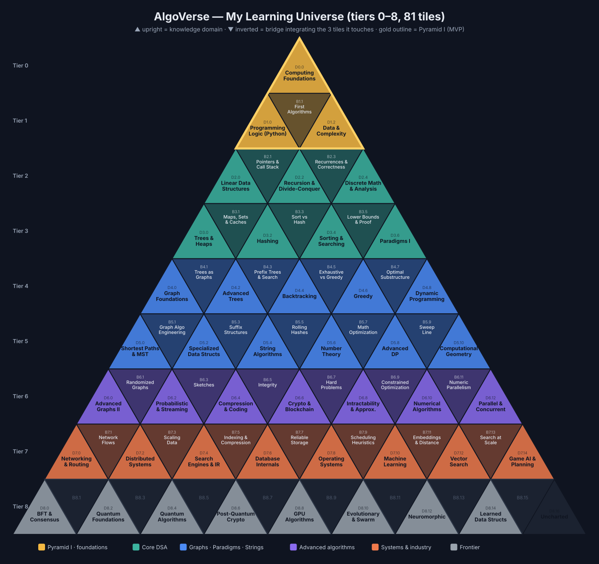
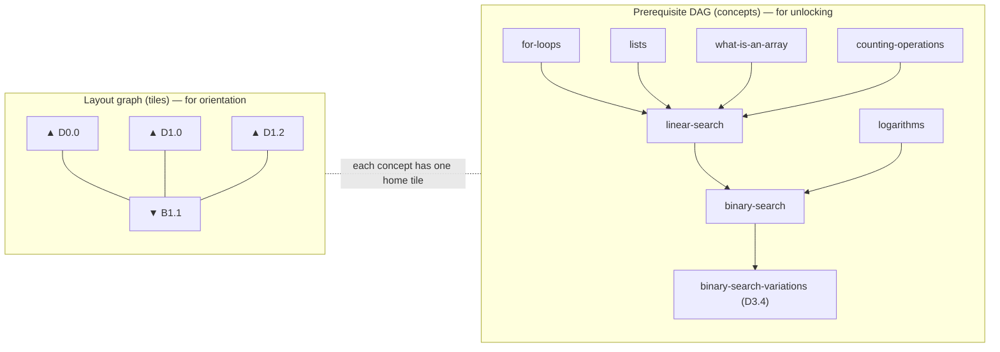
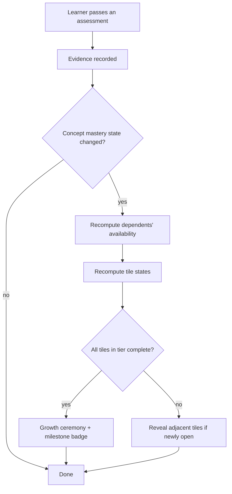

# AlgoVerse — The Expanding Pyramid Learning Architecture

> Deliverable 3. How the curriculum grows as an interconnected triangular structure, and how "My Learning Universe" renders it.



*The full universe as designed today: 9 tiers and 81 tiles. Pyramid I (gold outline) is the MVP. The map is drawn from the same coordinate maths described below.*

---

## 1. The idea in one picture

The brief asks for a structure that starts as one triangle. Triangles are then added alongside it, inverted triangles fill the gaps between them, and the whole grows into a larger equilateral triangle. That process is exactly a **triangular tessellation grown row by row**:

```text
Tier 0             ▲                    side 1  →  1 tile
Tier 1            ▲▼▲                   side 2  →  4 tiles   (Pyramid I)
Tier 2           ▲▼▲▼▲                  side 3  →  9 tiles
Tier 3          ▲▼▲▼▲▼▲                 side 4  → 16 tiles
Tier 4         ▲▼▲▼▲▼▲▼▲                side 5  → 25 tiles
 …                                       side s →  s² tiles
```

Every time a tier is added, the **whole universe is again a perfect, larger equilateral triangle**: base and height both grow by one. This is the "expanding pyramid".

| Shape | Meaning | Content role |
|---|---|---|
| ▲ Upright tile = **Domain** | A coherent knowledge domain (e.g. *Hashing*) | Teaches concepts in a progression from entry to advanced |
| ▼ Inverted tile = **Bridge** | The integration of the tiles it touches | Combines concepts from its neighbours into applications, comparisons, proofs and capstone challenges |

Geometry does real work here. An inverted tile physically touches **exactly three** upright tiles: its left and right neighbours in its row, and the domain directly above it. So every bridge integrates three domains, and every domain (except at the edges) participates in three bridges. **Islands are geometrically impossible.**

---

## 2. Coordinates and geometry (normative)

A tile is addressed by `(r, c)`, where `r ≥ 0` is the tier (row) and `0 ≤ c ≤ 2r` is the position in the row.

- **Orientation:** `c` even → upright ▲ (domain). `c` odd → inverted ▼ (bridge).
- Row `r` contains `r + 1` domains and `r` bridges.
- The universe through tier `R` contains `(R+1)²` tiles: `(R+1)(R+2)/2` domains and `R(R+1)/2` bridges.

**Adjacency (edge-sharing neighbours):**

| Tile | Neighbours |
|---|---|
| Bridge `(r, c)` with `c` odd | `(r, c−1)` left domain, `(r, c+1)` right domain, `(r−1, c−1)` domain above |
| Domain `(r, c)` with `c` even | `(r, c−1)` left bridge (if `c>0`), `(r, c+1)` right bridge (if `c<2r`), `(r+1, c+1)` bridge below |

**Vertex positions** (side length `S`, `h = S·√3/2`, apex at `(x₀, y₀)`):

```text
upright  (r, c), k = c/2:      top = (x₀ + (k − r/2)·S, y₀ + r·h)
                               bottom-left = top + (−S/2, h),  bottom-right = top + (+S/2, h)
inverted (r, c), k = (c−1)/2:  top-left = (x₀ + (k − r/2)·S, y₀ + r·h)
                               top-right = top-left + (S, 0),  bottom = top-left + (S/2, h)
```

These formulas live in one pure, unit-tested module (`apps/web/src/features/universe/geometry.ts`). The content validator uses the same rules (ported to Python in `content-tools`) to check that every bridge's `integrates:` list equals its geometric neighbours.

---

## 3. Two graphs, one picture

> **The pyramid is the visual map of the journey. It is not the prerequisite graph.**



| | Layout graph | Prerequisite graph |
|---|---|---|
| Nodes | Tiles (domains, bridges) | Concepts |
| Edges | Geometric adjacency | `requires` (hard), `recommends` (soft), `related`, `applies_to`, `generalizes` |
| Purpose | Orientation, motivation, sense of growth | Unlocking, recommendations, dependency explorer |
| Constraint | Fixed by geometry | Must be acyclic. Any tile → any tile allowed |

Consequences:
- A learner can open a concept in Tier 3 as soon as its **hard prerequisites** are met, even if Tier 2 is unfinished. This allows **alternative learning paths**.
- Cross-tile prerequisite edges are drawn as curved overlay links **on focus** (hover/selection), never all at once (that would be visual noise).
- Multiple dependencies are first-class: `requires: [a, b, c]` means all of them.

---

## 4. Inside a tile: the fractal zoom

Each tile is itself a small pyramid of concepts. Its layout is computed from the **intra-tile prerequisite depth**:

```text
          ▲  depth 0: entry concepts (no prerequisites inside this tile)
         ▲▲  depth 1
        ▲▲▲  depth 2
       ▲▲▲▲  depth 3: advanced / capstone
```

- Concept node position = (depth row, order within row by `sequence` hint in content).
- Entry concepts sit at the apex, matching the universe, where foundations sit at the top and growth flows downward.
- If a depth row has more nodes than fit, the row wraps and the tile scales. Layout is deterministic, which keeps visual regression tests stable.

**Semantic zoom levels**

| Zoom | What is drawn | Interactions |
|---|---|---|
| Z0 Universe | Tiles with names, state colours, progress rings; fogged tiles show a silhouette | Pan, zoom, click tile → Z1 |
| Z1 Tile | Concept nodes in the tile's mini-pyramid; bridge neighbours highlighted | Click concept → preview card |
| Z2 Concept card | Title, 1-line summary, status, mastery %, est. time, prerequisites (✓/✗), "unlocks" list | Start/continue lesson, open in Dependency Explorer |

Level-of-detail rendering: below a zoom threshold concept nodes are not mounted, so even 800 concepts stay cheap.

---

## 5. How the pyramid grows (state & reveal rules)

### 5.1 Tile states

| State | Rule | Visual |
|---|---|---|
| `fogged` | Not adjacent to any `open` tile | Dark silhouette, no name |
| `glimpsed` | Adjacent to an `open` tile | Name visible, dimmed, lock glyph |
| `open` | ≥ 1 concept in the tile is `available` | Outlined, tier colour |
| `in_progress` | ≥ 1 concept started | Partial fill = % core concepts proficient |
| `completed` | All ★ core concepts ≥ `proficient` | Solid fill |
| `mastered` | All ★ core concepts `mastered` + tile mastery challenge passed | Solid fill + glow + badge |
| `review_due` | Any mastered concept has FSRS retrievability < 0.85 | Subtle shimmer on the tile |

Concept states (`locked → available → started → practiced → proficient → mastered → review_due`) are defined in [GAMIFICATION](GAMIFICATION.md#33-mastery-state-machine).

### 5.2 Growth ceremony

When every tile in tier `r` is at least `completed`:

1. The super-triangle outline animates from side `r+1` to side `r+2` (base and height expand).
2. Tier `r+1` tiles move from `fogged` to `glimpsed`.
3. A milestone badge is awarded (e.g. *Pyramid II Builder*).

Respecting `prefers-reduced-motion`, the ceremony becomes a single cross-fade plus a toast.

The ceremony is **only visual**. Unlocking is driven by the prerequisite graph (§3), so learners on alternative paths are never blocked.



### 5.3 "The universe never feels finished"
- Tier 8 always contains the **Uncharted** tile and fogged bridges.
- New tiers can be appended indefinitely. Coordinates are unbounded, and the camera auto-fits.
- When new content ships, newly authored tiles appear with a "✨ new" marker.

---

## 6. Pyramid I — the first complete learning pyramid (MVP)

```text
                    ▲ D0.0
             Computing Foundations
        ▲ D1.0     ▼ B1.1      ▲ D1.2
   Programming    First       Data &
     Logic      Algorithms  Complexity
```

| Tile | Role | MVP core concepts |
|---|---|---|
| ▲ D0.0 Computing Foundations | What computing is; machine, memory, binary | 8 |
| ▲ D1.0 Programming Logic | Python thinking tools | 11 |
| ▲ D1.2 Data & Complexity | Arrays in memory; logs; counting cost; Big-O | 9 |
| ▼ B1.1 First Algorithms | **Integration:** loops + arrays + cost → search & sort | 6 |

The bridge B1.1 is where the three domains meet. Linear search needs loops (D1.0), arrays (D1.2) and the idea of an algorithm (D0.0). Binary search adds logarithms (D1.2). Sorting comparisons add growth rates and best/worst case (D1.2). The capstone *Search & Sort Showdown* tests all three together.

Full concept list: [CURRICULUM — Tier 1](CURRICULUM.md#tier-1--the-first-pyramid-side-2).

---

## 7. Content representation

```yaml
# content/tiles/b1-1-first-algorithms/tile.yaml
id: first-algorithms
kind: bridge            # domain | bridge
position: { row: 1, col: 1 }
title: First Algorithms
integrates: [computing-foundations, programming-logic, data-and-complexity]  # validated against geometry
tagline: Where loops, arrays and cost meet.
mastery_challenge: first-algorithms.search-and-sort-showdown
maturity: E
```

Validation rules (enforced by `content-tools validate`):
1. Positions are unique and `0 ≤ col ≤ 2·row`. `kind` matches the parity of `col`.
2. A bridge's `integrates` equals its geometric neighbours that exist (missing neighbours are allowed only at reserved slots).
3. Every concept has exactly one home tile. The prerequisite graph is acyclic.
4. Each bridge has ≥ 1 concept whose prerequisites span ≥ 2 of its integrated domains (it must *actually* integrate).
5. Every tile has ≥ 1 ★ core concept, except reserved slots.

---

## 8. Rendering design (summary)

- **Renderer:** custom SVG layer in React, with `d3-zoom` for pan/zoom/inertia. Triangles are `<polygon>`s from the geometry module. See [DECISIONS ADR-006](DECISIONS.md).
- **Overlays:** prerequisite links (curved paths) on focus; recommended path as an animated dashed line; search-to-focus camera transition.
- **Accessibility:** the universe has a parallel **list view** (tiers → tiles → concepts) with full keyboard navigation. Arrow keys move between adjacent tiles using the adjacency table in §2. Every tile has an accessible name such as "Bridge: First Algorithms, in progress, 3 of 6 core concepts".
- **Minimap:** a small fixed-scale render of the whole triangle with the viewport rectangle.
- **Performance:** ≤ 81 tiles + ≤ 800 concept nodes. LOD culling keeps it at 60 fps on integrated GPUs.
