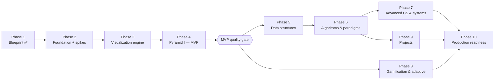
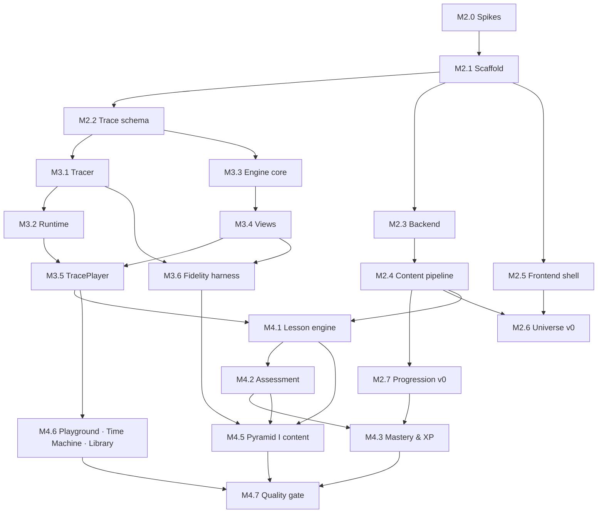

# AlgoVerse — Phased Implementation Roadmap

> Deliverable 13 (phased roadmap and detailed implementation plan) and Deliverable 15 (risk assessment).
> Living document: updated after every milestone (brief rule 14). Status lives in [PROGRESS](PROGRESS.md).

Sizes are relative (**S** ≈ a few focused days, **M** ≈ 1–2 weeks, **L** ≈ 3–4 weeks of one full-time developer working with Claude Code). They are for sequencing, not commitments.

---

## 1. Phase overview

| Phase | Goal | Size | Exit gate (summary) |
|---|---|---|---|
| 1 Blueprint | All design deliverables | — | Owner approves the blueprint ✅ *(pending review)* |
| 2 Foundation | Monorepo, API, DB, content pipeline, shell, Universe v0, progression engine v0; **de-risking spikes first** | L | Fixture curriculum flows from `content/` → DB → Universe; spikes confirm runtime assumptions |
| 3 Visualization engine | Tracer + browser runtime + engine core + array family views + TracePlayer | L | 5 algorithms animated from real traces with zero per-algorithm code; fidelity tests pass |
| 4 Pyramid I (MVP) | Lesson engine, assessment, mastery, gamification basics, 34 lessons, Playground, Time Machine basic | L+L | Learner usability study passes the MVP quality gate (§4) |
| 5 Data structures | Linked lists, stacks/queues, hashing, trees, heaps; DS Lab (Build Your Own); Dependency Explorer | L | Tiers 2–3 DS concepts live with fidelity tests |
| 6 Algorithms | Recursion, D&C, advanced sorting/searching, graphs, paradigms; Battle Arena; recursion-tree/graph/DP views | L+L | Tiers 2–4 complete; Arena live |
| 7 Advanced CS | Tiers 5–8: advanced structures and algorithms, systems, AI, frontier; matrix/geometry/timeline views | XL (content-heavy, parallel tracks) | Each tile passes content CI + review |
| 8 Gamification & adaptive | FSRS reviews, misconception engine, recommender v2, challenges, full badges, Reverse Engineering, Judge service | L | Adaptive metrics instrumented; Judge passes security suite |
| 9 Projects | 15 engineering projects | L | Each project runs end-to-end with tests and a visualization |
| 10 Production | Security hardening, perf, a11y audit, cloud accounts, deployment, backup/restore drills, docs | L | Release checklist (§3, Phase 10) green |

---

## 2. Detailed implementation plan — Phases 2–4 (the MVP)

Each task lists **output**, **tests** and **done when**. After blueprint approval, Phase 2 is expanded into a step-by-step, test-first execution plan in `docs/plans/`.

### Phase 2 — Application foundation

#### M2.0 De-risking spikes (do first; throwaway code, findings kept) — S/M
| Spike | Question answered | Pass condition |
|---|---|---|
| S1 Pyodide worker + COOP/COEP | Does Pyodide run in a module worker under Vite dev **and** a production static server with cross-origin isolation? | `crossOriginIsolated === true`; Python `1+1` in worker; self-hosted assets |
| S2 Tracer prototype | `settrace` + AST rewrite of compares/subscripts inside Pyodide: overhead and events/sec | Bubble sort n=50 traced (≈ 3–5k events) in < 1.5 s on a mid-range laptop |
| S3 Interrupts & kill | Soft interrupt via SharedArrayBuffer + hard `terminate()` + re-boot time | `while True` stopped < 1 s soft; re-boot < 2 s warm |
| S4 Memory measurement | Is `tracemalloc` usable in Pyodide? WASM memory ceiling behaviour | Documented; fallback chosen |
| S5 Animation | Custom tween engine: 300 SVG bars swapping at 60 fps; 5k Canvas bars | Meets NFR-02 |
| S6 Universe geometry | Triangular SVG map with d3-zoom + LOD, 81 tiles + 800 nodes | 60 fps pan/zoom |

**Output:** `docs/spikes/` report + ADR updates (confirm or revise ADR-003/004/005/006).

#### M2.1 Monorepo scaffold — S
- **Output:** pnpm workspace (`apps/web`, `packages/viz-engine`, `packages/trace-schema`), uv workspace (`apps/api`, `packages/tracer`, `packages/content-tools`), Makefile, ESLint + Prettier + `eslint-plugin-boundaries`, Ruff + mypy + import-linter, pre-commit hooks, GitHub Actions CI skeleton, `.editorconfig`, MIT/Apache license decision (see open questions).
- **Done when:** `make lint test` passes on Windows, macOS and Linux CI runners with placeholder tests.

#### M2.2 Trace schema package — S
- **Output:** `trace-schema/schema/v1/*.json` (values, heap, events, trace envelope, view specs); generators → `ts/` types and `py/` Pydantic models; versioning policy.
- **Tests:** schema validates the golden example traces; TS and Pydantic round-trip the same fixture.
- **Done when:** both languages import generated types; CI fails if generated files are stale.

#### M2.3 Backend foundation — M
- **Output:** FastAPI app factory, settings (pydantic-settings), SQLAlchemy 2 session, Alembic baseline, RFC 9457 errors, request IDs, structlog, `/healthz` `/readyz`, local-mode auth (implicit user), CSRF middleware, module skeletons (`content`, `universe`, `progress`, `users`, `auth`), import-linter contracts.
- **Tests:** API tests on SQLite + Postgres (Testcontainers); migration up/down.
- **Done when:** `GET /api/v1/me` returns the local user; CI green on both DBs.

#### M2.4 Content pipeline v0 — M
- **Output:** Pydantic schemas for `tile`, `concept`, `lesson` front-matter, `viz`, `items` (subset); `content-tools validate | graph | build | publish`; geometry/adjacency validation; fixture curriculum (Pyramid I tiles with stub concepts); content API: `/content/release`, `/content/graph`, `/content/tiles/{id}`, `/content/concepts/{id}`, `/content/lessons/{id}`.
- **Tests:** schema error messages with file:line; cycle detection; bridge adjacency; publish idempotency.
- **Done when:** editing a YAML file and running `make content` changes API output with no code changes.

#### M2.5 Frontend foundation — M
- **Output:** Vite + React 19 + TS strict; router with 10 sections + settings; app shell (nav rail, top bar, command palette); design tokens (light/dark/high-contrast) in Tailwind v4 + CSS variables; Radix primitives wrapped in `ui/`; generated OpenAPI client + TanStack Query; i18n scaffold; error boundaries; COOP/COEP dev headers.
- **Tests:** component tests for shell and navigation; axe on every route; Playwright smoke.
- **Done when:** every nav section routes to a placeholder, theme toggle works, keyboard navigation reaches everything.

#### M2.6 Universe v0 + Dashboard v0 — M
- **Output:** `geometry.ts` (coordinates, adjacency, super-triangle); SVG renderer with d3-zoom; tile states from the API; concept nodes inside tiles at zoom Z1; preview card; list-view alternative; Dashboard v0 (continue learning, mini-pyramid, recommended next placeholder).
- **Tests:** geometry unit tests (property: adjacency symmetric, counts = (R+1)²); visual regression of the universe; keyboard tile navigation E2E.
- **Done when:** clicking a concept navigates to `/learn/{conceptId}`.

#### M2.7 Learning progression engine v0 — S/M
- **Output:** `learner_concept`/`learner_section` tables; `POST /progress/events`; availability computation from `requires` edges; tile state projection; `/universe` endpoint; domain event bus.
- **Tests:** state machine transitions; availability with multiple prerequisites; idempotent events.
- **Done when:** marking fixture concepts proficient (via a dev endpoint) unlocks dependents and lights tiles.

**Phase 2 acceptance criteria:** fixture curriculum renders in Universe and Curriculum; progression engine unlocks correctly; CI runs lint, type, unit and integration on SQLite + Postgres; spikes documented with ADRs confirmed.

### Phase 3 — Visualization engine

#### M3.1 Tracer v1 (Python) — L
- **Output:** `algoverse_tracer`: `instrument()` (compare incl. chained, subscript get/set/del, aug-assign, swap groups, allow-listed method calls, `heapq`/`bisect` wrappers, attribute writes), `settrace` backend (frames, locals deltas, call/return/exception), serializer (stable ids, caps, cycles), origins registry, limits (steps, time, output, recursion), counters, seeded determinism, friendly-error rules v1; wheel build for Pyodide.
- **Tests:** golden traces for 5 reference algorithms; Hypothesis semantics-preservation suite; span accuracy; determinism hash.
- **Done when:** traces validate against schema v1 in CPython and Pyodide (via Node test harness).

#### M3.2 Browser runtime — M
- **Output:** worker entry (boot, hardening: import deny-list, global deletion), typed RPC, `RunnerClient` (queue, pre-warm, watchdog, soft/hard interrupt, re-boot), chunked trace transfer, stdout streaming, stdin buffer, Service Worker caching of Pyodide.
- **Tests:** Playwright runtime suite incl. limits and sandbox cases ([TESTING §7](TESTING.md#7-security-tests)).
- **Done when:** infinite loop, memory bomb, deep recursion, `import js` all handled with friendly messages and the next run works.

#### M3.3 Engine core — L
- **Output:** `trace-model` (columnar index, keyframes, `snapshotAt`, `diff`), `semantic` (compare, swap, move, assign, read, call/return), `expr` (safe evaluator), `playback` (state machine, granularity micro/line/iteration/call, speed, breakpoints, prediction-gate hooks), `narration` (templates, i18n, span-anchored authored narration with hash guard).
- **Tests:** property tests (snapshot reconstruction), op detection fixtures, playback reducer tests, evaluator fuzzing.

#### M3.4 Views & rendering — L
- **Output:** scene model; adapters `array`, `bars`, `search`, `variables`, `call-stack`, `memory` (basic Auto View); SVG renderer; Canvas bars renderer; tween animator with choreography (compare pulse, swap arcs, move ghosts), reduced-motion mode; theme token mapping incl. patterns.
- **Tests:** golden scenes; animator with fake clock; perf benchmarks (NFR-02).

#### M3.5 TracePlayer widget — M
- **Output:** stage + CodeMirror code panel with line and sub-expression decorations + inspector (watches, derived values, changed markers) + call stack + output + playback bar + keyboard shortcuts + resizable panes + layout presets.
- **Tests:** component tests; E2E sync test (highlight span, inspector values, scene agree at step N).

#### M3.6 Fidelity harness — S
- **Output:** content CI step that runs every algorithm concept's reference code and asserts scene state == snapshot state at every step; golden op sequences.

**Phase 3 acceptance criteria:** linear search, binary search, bubble, selection and insertion sort are animated from real traces with **no algorithm-specific engine code** (only YAML specs); backward stepping is exact; editing reference code re-traces and re-animates; fidelity + performance budgets pass.

### Phase 4 — First complete learning pyramid (MVP)

#### M4.1 Lesson engine — M
Block registry (markdown, analogy, illustration, storyboard, animation, code, trace-player, inspector config, complexity-table, growth-chart, op-count-experiment, application-cards, experiment, exercise-set, connections, checkpoint); remark-directive pipeline; section stepper with resume; test-out path. **Done when:** a fixture lesson using every block renders and resumes.

#### M4.2 Assessment v1 — L
Item types: `mcq`, `multi-select`/`explain-by-reasons`, `numeric`, `predict-next-step`, `trace-the-variable`, `parsons`, `find-the-bug`, `code-with-tests`, `complexity-pick`; item templates + generators (trace-derived answers) in content-tools and browser; server-graded checkpoints with instance pools; misconception mapping + follow-up activities; hints with cost. **Done when:** the binary-search checkpoint runs end-to-end with server grading and remediation.

#### M4.3 Mastery & gamification v1 — M
KC Elo, mastery state machine, unlocking from `proficient`, tile completion; XP ledger + levels + streak + daily goal + 10 seed badges (rules engine); toasts. **Done when:** watching earns 0 XP; a full concept journey produces the correct ledger entries exactly once.

#### M4.4 Storyboards for Tier 0 — S
Storyboard runtime on the shared scene/animator stack; toy CPU, memory lockers, bit switches.

#### M4.5 Pyramid I content — L (parallelizable by tile)
Order: **B1.1** (6 lessons: proves the full template on algorithms) → **D1.2** (9) → **D0.0** (8) → **D1.0** (11). Each lesson: 12 sections, misconceptions, ≥ 2 item templates, ≥ 6 static items, checkpoint, and for algorithm concepts verified complexity + fidelity. Plus ~20 problems and the *Search & Sort Showdown* capstone.

#### M4.6 Supporting screens — M
Playground v1 (Run / Visualize / Debug with omniscient stepping, examples, local snippets); Time Machine basic (scrub, jump, before/after diff, 3 query kinds); Library v1 (search, concept pages, cheat sheet); Dashboard v1; My Progress v0.

#### M4.7 Quality gate iteration — M
Usability study, fixes, performance and accessibility audit.

---

## 3. Later phases — scope and acceptance criteria

**Phase 5 — Data structures expansion.** Views: linked-list, stack/queue/deque, hash-table, tree (BST/heap twin view). DS Lab with React Flow builder ⇄ Python round-trip and invariant checker. Dependency Explorer. Content: D2.0, B2.1, D3.0, B3.1, D3.2. *Acceptance:* every DS operation animated from traces; DS Lab round-trips a 10-node BST; Explorer shows paths with mastery overlay.

**Phase 6 — Algorithm expansion.** Views: recursion-tree, graph (stable layout), dp-table (truthful dependency arrows). Battle Arena (distributions, counters, growth charts, theory overlay). Content: D2.2, B2.3, D2.4, B3.3, D3.4, B3.5, D3.6, Tier 4. `sys.monitoring` backend benchmark. *Acceptance:* Dijkstra, BFS/DFS, merge/quick sort, knapsack and LCS fully visual; Arena explains outcomes; problem lab ≥ 300 problems with pattern tags.

**Phase 7 — Advanced CS.** Views: matrix, geometry, parallel-timeline. Content: Tiers 5–8 in parallel tracks (graphs/strings/math; systems; AI/vector search; frontier) with maturity labels and `review_by` dates. *Acceptance:* each tile passes content CI + two-person review; frontier tiles cite primary sources.

**Phase 8 — Gamification & adaptive.** FSRS reviews, misconception engine v2, recommender v2 with reasons, all challenge types, full badge catalogue, Reverse Engineering mode, Judge service (containers, job table, WebSocket streaming), opt-in leaderboards. *Acceptance:* review retention metric instrumented; Judge passes the security suite; recommendations explainable.

**Phase 9 — Projects.** 15 projects (search engine → vector search) with milestones, starter code, tests, architecture diagrams and system-level visualizations. *Acceptance:* each project completes end-to-end on a clean install.

**Phase 10 — Production readiness.** Cloud accounts, rate limiting, CSP hardening, untrusted-code iframe isolation, gVisor for Judge, performance optimization, WCAG 2.2 AA external audit, docs (user guide, author guide, ops runbooks), Postgres backups + PITR + restore drill, Docker images, release process. *Acceptance:* release checklist green; restore drill succeeds; security scan clean.

---

## 4. MVP quality gate ("do not move forward until Pyramid I is excellent")

| Criterion | Threshold |
|---|---|
| Fidelity | 100% of Pyramid I algorithm lessons pass fidelity tests |
| Correctness | 100% reference implementations pass tests + property tests + complexity verification |
| Usability | 5–8 target learners (≥ 3 absolute beginners) complete *What is an algorithm* → *Binary Search*. SUS ≥ 80. No blocker issues |
| Learning | Median pre→post gain ≥ 30 pp on Pyramid I concept checks |
| Engagement | ≥ 70% of study participants choose to continue to a second concept unprompted |
| Performance | All budgets in [TESTING §6](TESTING.md#6-performance-tests) met |
| Accessibility | Keyboard-only and screen-reader walkthrough of one full lesson succeeds; axe clean |

---

## 5. Development sequence (critical path)

Parallel tracks once M2.2 lands: **(a)** backend + content pipeline, **(b)** tracer + runtime, **(c)** engine + views, **(d)** frontend shell + universe. Content authoring for B1.1 starts as soon as the content schema and tracer exist, using CLI verification before the lesson UI is ready.

---

## 6. Risk assessment & mitigation (Deliverable 15)

| # | Risk | L | I | Mitigation |
|---|---|---|---|---|
| R1 | Tracing overhead in Pyodide makes traces slow for bigger inputs | M | H | Spike S2 first; trace only user frames; delta serialization; step limits with sampled playback; `sys.monitoring` backend; `run` mode without tracing |
| R2 | Pyodide download (~10 MB+) hurts first-run experience | H | M | Lazy-load during lesson section A; Service Worker cache; show storyboard/static content meanwhile; self-host with compression |
| R3 | Instrumentation changes program semantics in edge cases | M | H | Wrappers delegate to real operators; Hypothesis equivalence suite; per-node fallback with `degraded` flag; tracer never instruments library code |
| R4 | **Content production is the bottleneck** (~665 high-quality lessons) | H | H | Template-driven lessons; trace-generated items; strict CI so reviewers focus on pedagogy; prioritize by learner demand; author guide; parallel authoring tracks; authoring aids are allowed, but every claim must pass validation + human review |
| R5 | Visual clutter for complex algorithms (flows, HLD, HNSW) | M | M | Progressive disclosure; per-view focus modes; storyboard overviews before traces; usability testing per tile |
| R6 | Visual-first product excludes learners using screen readers | M | H | Narration per step, list views, textual state summaries, keyboard activities (built in from Phase 3, not retrofitted) |
| R7 | COOP/COEP isolation blocks embedding third-party resources | M | L | Self-host all assets (already a principle); CORP headers on own assets |
| R8 | Mastery model mis-calibrated (too strict, so learners feel blocked; too lax, so mastery is meaningless) | M | H | Unlock at `proficient`; thresholds in config; analytics on pass rates; calibrate in the MVP study |
| R9 | Safari/WebKit WASM or SharedArrayBuffer quirks | M | M | Cross-browser E2E from Phase 3; graceful fallback (no soft interrupt → hard kill only) |
| R10 | Shared code could be malicious once sharing exists | L (MVP) | H | No auto-run; untrusted-mode opaque-origin iframe; Phase 10 hardening before enabling sharing publicly |
| R11 | Emerging-topic content becomes outdated or overclaims | M | M | Maturity labels; `review_by` dates enforced by CI; primary-source citations required |
| R12 | Scope creep from a very ambitious vision | H | H | Phase gates; MVP = Pyramid I only; DECISIONS.md for every addition; "fits the architecture?" check (brief §16) |
| R13 | SQLite/Postgres behaviour drift | L | M | Run the integration suite on both; avoid DB-specific SQL |
| R14 | Knowledge concentrated in one developer | M | M | Docs-as-code, ADRs, PROGRESS updates per milestone, high test coverage |

---

## 7. Roadmap maintenance
- After each milestone: update [PROGRESS](PROGRESS.md), revise sizes and risks here, and record decisions in [DECISIONS](DECISIONS.md).
- Any new feature proposal must state: which module(s), which engines it reuses, its content-schema impact, and its test plan.
