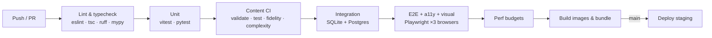

# AlgoVerse — Testing & Quality Assurance Strategy

> Deliverable 12. Correctness before smoothness: *"The application must not sacrifice correctness for animation smoothness."*

---

## 1. Test pyramid & tools

```text
                  ▲  Manual exploratory + accessibility audits (per release)
                 ▲▲▲  E2E (Playwright): critical learner journeys, cross-browser
               ▲▲▲▲▲  Integration: API + DB (SQLite & Postgres), worker + engine, content bundle
            ▲▲▲▲▲▲▲▲  Unit: engine (pure TS), tracer (Python), services, geometry, scoring
       ▲▲▲▲▲▲▲▲▲▲▲▲▲  Content CI: every reference algorithm, trace, item generator and complexity claim
```

| Layer | Tools |
|---|---|
| TS unit & component | Vitest, @testing-library/react, fast-check (property-based) |
| Python unit | pytest, Hypothesis (property-based), coverage.py |
| API integration | pytest + httpx `AsyncClient`, Testcontainers (Postgres) / temp SQLite |
| Browser runtime | Playwright driving the real Pyodide worker |
| E2E | Playwright (Chromium, Firefox, WebKit) |
| Visual regression | Playwright screenshot comparisons of golden scenes and key screens (light & dark) |
| Accessibility | axe-core in Playwright + manual screen-reader passes (NVDA, VoiceOver) per release |
| Performance | Playwright + `performance.mark`, Lighthouse CI budgets, engine micro-benchmarks (Vitest bench) |
| Security | Sandbox escape suite, ZAP baseline scan on the API, `pip-audit` / `pnpm audit`, Bandit, Semgrep |

---

## 2. Unit tests

| Area | What is tested | Example |
|---|---|---|
| Data structure operations (reference implementations) | Correct results + invariants after every operation | Heap property after each `heappush`; BST in-order is sorted; DSU find/union consistency |
| Algorithm correctness | Against known cases **and** properties | `sort(xs) == sorted(xs)` for 10k Hypothesis-generated lists including duplicates, negatives, empty, single; stability check with tagged records |
| Complexity-related edge cases | Best/worst inputs trigger expected op counts | Insertion sort on sorted input makes exactly n−1 comparisons. On reversed input it makes n(n−1)/2 |
| Python execution events | Tracer emits correct events with correct spans | Golden op sequences, origin tracking for swaps/shifts, chained comparisons, exceptions mapped to user lines |
| Instrumentation semantics | Instrumented ≡ uninstrumented behaviour | Hypothesis-generated programs (expressions, loops, subscripts, custom `__lt__`) |
| Trace model | Keyframes + deltas reconstruct exact snapshots | `snapshotAt(k)` equals a full replay for random k |
| Semantic analyzer | Op detection rules | Crossing writes → swap; same-origin write → move |
| Adapters & scenes | View model correctness | Array adapter tokens, pointer positions; tree layout determinism |
| Playback | State machine & granularity mapping | Switching granularity keeps position; prediction gates pause |
| Safe expression evaluator | Parsing, evaluation, rejection of unsafe constructs | `__class__`, calls to non-whitelisted functions rejected |
| Pyramid geometry | Coordinates, adjacency, counts | Bridge (r,c) neighbours; universe through tier R has (R+1)² tiles |
| Mastery/XP/FSRS | Scoring maths & state transitions | Elo update bounds; ledger idempotency; streak rollover across timezones/DST |

**Coverage targets:** `viz-engine` ≥ 90%, `tracer` ≥ 90%, API services ≥ 85%, UI components ≥ 70% (behavioural, not snapshot-heavy).

## 3. Fidelity tests (the core guarantee)

For **every** `kind: algorithm` concept, content CI:
1. Runs the reference code under the tracer for each fixture input.
2. Builds the scene at **every step** with the concept's view spec.
3. Asserts visual state == program state (cell values in order, pointer indices, region bounds, highlighted elements match the op's operands).
4. Compares the semantic op sequence with a golden file. Diffs are reviewed in PRs.

A concept cannot be published if any fidelity test fails.

## 4. Integration tests

| Flow | Assertions |
|---|---|
| Lesson loading | Every compiled lesson renders all 12 sections with no console errors (smoke over the entire bundle) |
| Visualization synchronization | For a trace, the code panel highlight span, inspector values and stage scene agree at sampled steps |
| Code execution | Worker boots, runs, streams output, enforces limits, recovers after a hard kill |
| Progress tracking | Section events → `learner_section`; idempotent on replay |
| Assessment workflows | Checkpoint start → attempts → finish → mastery decision → XP ledger entry → FSRS card → tile state |
| Content publish | `content-tools publish` twice is idempotent; activating a previous release rolls back |
| DB portability | Full integration suite on SQLite **and** PostgreSQL |

## 5. End-to-end scenarios (Playwright)

1. **Registration & first session:** sign up (cloud) or start local → onboarding → open Universe → start *What is an algorithm?* → complete section checks → XP toast.
2. **Opening a concept:** Universe → zoom into B1.1 → click *Binary Search* → preview card → Start.
3. **Running an animation:** play, pause, step back, change speed, change granularity, jump to step; verify narration text and code highlight at step N.
4. **Executing Python:** Experiment → edit code (`lo = mid`) → infinite loop caught → friendly message → reset to reference.
5. **Completing an assessment:** answer a prediction wrongly → see remediation → finish checkpoint → pass.
6. **Updating mastery:** concept shows *mastered*. Dependent concepts become *available*. Tile progress ring updates. Review scheduled.
7. **Keyboard-only:** complete scenario 3 with keyboard only.
8. **Offline (local mode):** load, go offline, continue the lesson, reconnect, and progress syncs.

## 6. Performance tests

| Scenario | Budget |
|---|---|
| Large array visualization (bars, n = 2,000, Canvas) | ≥ 45 fps during playback; step < 16 ms |
| Large graph (1,000 nodes / 5,000 edges, Canvas) | Initial layout < 1.5 s (seeded, cached); pan/zoom ≥ 45 fps |
| Deep recursion (depth 1,000; 20k events) | Trace < 3 s; call-stack view virtualized |
| Complex tree operations (AVL with 500 inserts) | Scene per step < 16 ms; rotations animate smoothly |
| Long-running algorithm (100k-step program) | `run` mode completes; `trace` mode stops at the limit with an explanation and offers sampled playback |
| App start | Shell interactive < 2 s on a mid-range laptop (cold, throttled 4G profile excluded); Pyodide warm < 1 s from cache |

## 7. Security tests

| Category | Cases |
|---|---|
| Sandbox isolation | `import js`, `pyodide.ffi`, `micropip`, `pyodide.http.pyfetch`; `__import__` / `importlib` bypasses; `globals()['__builtins__']` manipulation; `sys.modules` tampering; access to `self.fetch` via any bridge → all blocked or harmless; worker `fetch` undefined |
| Resource exhaustion | Infinite loops, fork-style recursion, huge allocations, output floods, giant ints (`10**10**7`) → limits trigger, UI recovers, new worker boots |
| Unauthorized access | Accessing another user's progress/snippets → 404. Role escalation attempts. Missing CSRF → 403. Session fixation |
| Data validation | Oversized payloads, malformed JSON, injection in search (`q`), Markdown/HTML injection in content (no raw HTML rendered) |
| Assessment integrity | Checkpoint answer keys absent from all client responses before submission (contract test scanning responses) |
| Judge (Phase 8+) | Network egress attempts, filesystem writes outside tmpfs, PID exhaustion, privilege escalation → contained; container destroyed |

## 8. Content QA

- `content-tools validate/graph/test/verify-complexity` gate every content PR.
- **Accuracy review checklist** (PR template): claims cite references; average vs worst case distinguished; deterministic vs randomized stated; assumptions listed; edge cases covered; maturity label correct.
- Two-person review for new algorithm concepts (author + reviewer with domain expertise).
- **Learner-reported issues:** a "Report a problem with this step" button attaches the trace step and concept version.

## 9. CI pipeline



## 10. Definition of Done (every feature)
1. Acceptance criteria met and demonstrated.
2. Unit + integration tests written and passing. E2E updated for affected journeys.
3. Accessibility: keyboard path works, axe clean, narration/labels present.
4. Performance budgets unchanged or improved.
5. Docs updated (`PROGRESS.md`, relevant design doc, ADR if a decision was made).
6. No feature is marked complete in `PROGRESS.md` without passing tests (brief rule 15).
