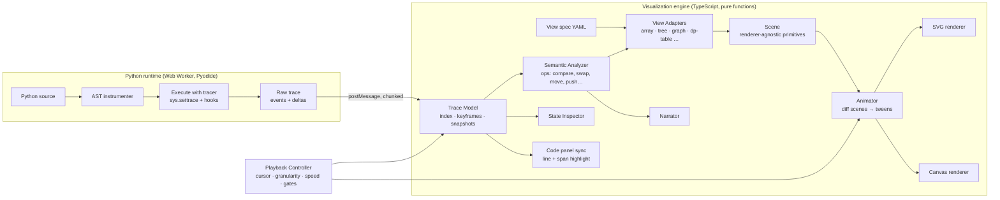
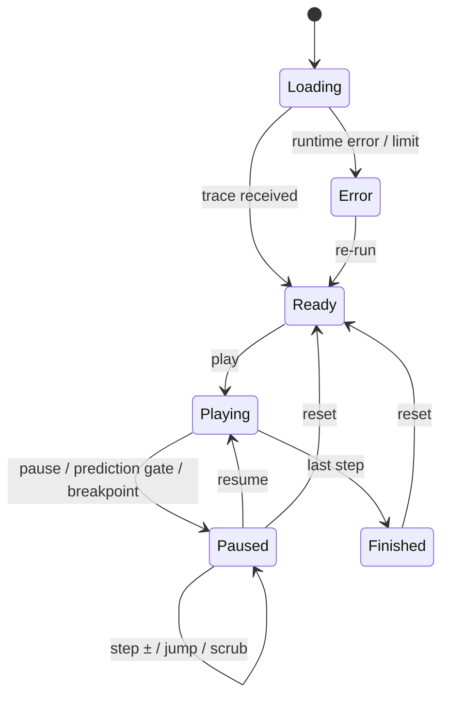

# AlgoVerse — Algorithm Visualization Engine

> Deliverable 6, including the Algorithm Time Machine (brief §18). The engine is **one reusable pipeline** that turns real Python execution into synchronized, explainable animations for every algorithm and data structure.

---

## 1. Guarantees

| # | Guarantee | How it is achieved |
|---|---|---|
| V1 | **Truthful:** every visual state equals the real program state at that step | Visual = pure function of (trace snapshot, view spec). Fidelity tests assert it |
| V2 | **Explainable:** the learner sees *what changed and why* | Semantic ops (compare/swap/visit/relax…) + narration + exact source-span highlight |
| V3 | **Deterministic & reversible:** step back/forward/jump/replay any time | Trace is immutable data. Keyframes + deltas give O(1)-ish random access |
| V4 | **Reusable:** no per-algorithm animation code | Algorithms differ only in their *view spec* (YAML bindings), never in engine code |
| V5 | **Decoupled:** visuals are not coupled to Python source text | Engine consumes trace events. No regex/text matching of code |
| V6 | **Scalable:** small arrays look beautiful; large inputs stay smooth | SVG renderer ≤ ~300 elements, Canvas renderer beyond; trace windowing |
| V7 | **Accessible:** usable with keyboard, screen readers, reduced motion | Narration per step, tokens with patterns + colours, motion scaling |

---

## 2. Pipeline overview



Every box inside **Engine** is a pure TypeScript module with no React dependency. React components only *host* the renderers and controls. That makes the engine unit-testable in Node and reusable in the Playground, lessons, Battle Arena, Time Machine, Reverse Engineering and item generation.

---

## 3. Execution event schema (trace schema v1)

The schema is defined once as **JSON Schema** in `packages/trace-schema/`. TypeScript types and Pydantic models are generated from it, so the Python tracer and the TS engine cannot drift.

### 3.1 Values and the heap

```ts
// Primitives are inlined; mutable/compound objects live in the heap and are referenced by stable id.
type Value =
  | { t: "int"; v: string }            // string to keep big ints exact
  | { t: "float"; v: number | "nan" | "inf" | "-inf" }
  | { t: "bool"; v: boolean }
  | { t: "str"; v: string; truncated?: true }
  | { t: "none" }
  | { t: "ref"; id: ObjId };           // e.g. "o17"

interface HeapObject {
  id: ObjId;
  kind: "list" | "tuple" | "dict" | "set" | "frozenset" | "deque" | "instance" | "function" | "class" | "other";
  typeName: string;                    // "list", "Node", "collections.deque"
  items?: Value[];                     // list/tuple/deque/set (sets in stable insertion-observed order)
  entries?: [Value, Value][];          // dict
  fields?: Record<string, Value>;      // instance attributes
  len: number;
  truncated?: boolean;                 // capped for display (configurable, default 1000 items)
}
```

**Stable object identity.** The tracer maps CPython `id()` to sequential ids (`o1, o2, …`) on first sight and keeps a strong reference to every seen object for the trace's lifetime. CPython can reuse `id()` values after an object is garbage-collected, and keeping the reference prevents two different objects from sharing an id inside one trace. Memory is bounded by the step limit.

### 3.2 Events

```ts
interface Span { line: number; col: number; endLine: number; endCol: number } // in the learner's source

type TraceEvent = Base & (
  | { kind: "line" }                                                    // a statement is about to run
  | { kind: "call";   func: string; frameId: FrameId; parent?: FrameId; args: Record<string, Value> }
  | { kind: "return"; frameId: FrameId; value: Value }
  | { kind: "exception"; excType: string; message: string; traceback: Span[] }
  | { kind: "compare"; op: "<" | "<=" | ">" | ">=" | "==" | "!=" | "is" | "in" | "not in";
      left: Value; right: Value; result: boolean; leftOrigin?: Origin; rightOrigin?: Origin }
  | { kind: "read";  container: ObjId; key: Value; value: Value }       // obj[key]
  | { kind: "write"; container: ObjId; key: Value; old?: Value; value: Value; valueOrigin?: Origin }
  | { kind: "delete"; container: ObjId; key: Value }
  | { kind: "method"; target: ObjId; method: string; args: Value[]; result: Value }   // append, pop, popleft, heappush…
  | { kind: "attr_write"; target: ObjId; attr: string; old?: Value; value: Value }   // node.next = other
  | { kind: "stdout"; text: string }
  | { kind: "note"; text: string; data?: Record<string, Value> }        // opt-in av.note() in reference code
);

interface Base {
  seq: number;              // 0..N-1, total order
  span?: Span;              // exact source range (statement or sub-expression)
  frameId?: FrameId;
  depth: number;            // call depth
  delta?: StateDelta;       // state changes caused since previous event
}

interface StateDelta {
  locals?: Record<FrameId, Record<string, Value | { t: "deleted" }>>;
  heap?: Record<ObjId, HeapObject | { deleted: true }>;
  frames?: { push?: FrameInfo; pop?: FrameId };
}

interface Origin { container: ObjId; key: Value }  // provenance: "this value was read from arr[j]"
```

### 3.3 Trace envelope

```ts
interface Trace {
  schemaVersion: "1.0";
  meta: {
    runId: string; pythonVersion: string; entry?: string;
    source: { name: string; text: string; sha256: string }[];
    seed: number;                               // deterministic random
    limits: { maxSteps: number; timeoutMs: number; maxHeapItems: number };
    terminatedBy: "completed" | "step_limit" | "timeout" | "error" | "cancelled";
    loops: { span: Span; kind: "for" | "while"; depth: number }[];  // from AST, for iteration granularity
  };
  events: TraceEvent[];
  counters: { lines: number; comparisons: number; reads: number; writes: number; swaps: number; calls: number; maxDepth: number };
  stdout: string;
  error?: { excType: string; message: string; span?: Span; friendly?: string };
}
```

The example in §12 shows a real bubble-sort fragment in this format.

---

## 4. Trace Model (time-travel foundation)

- **Indexing:** events are stored in typed arrays/columns where useful (kind, depth, line) for fast filtering.
- **Keyframes:** a full snapshot (`frames`, `locals`, `heap`) every `K = 128` events, built once when the trace arrives (in a worker if the trace is large). `snapshotAt(seq)` = nearest keyframe ≤ seq + apply ≤ 127 deltas. Results are LRU-cached.
- **Reverse stepping** is just `snapshotAt(seq − 1)`. Nothing is "undone", so it is always exact.
- **Diff:** `diff(seqA, seqB)` returns changed locals, heap objects and container cells (used by the Time Machine "before/after" view and narration).

---

## 5. View specs: binding program state to visuals

A view spec says *which program state to show and how to interpret it*. It never says *when to animate what*. The full YAML schema is in [CONTENT_SCHEMA §3.2](CONTENT_SCHEMA.md#32-visualization-spec-vizyaml).

```yaml
views:
  - type: array
    source: arr                 # expression evaluated on each snapshot (safe evaluator, see §10)
    pointers: { i: i, j: j }    # pointer markers from locals
    regions: [{ from: "n - i", to: "n - 1", style: sorted }]   # e.g. bubble sort's sorted suffix
```

- Bindings are **expressions over snapshots** (names, indexing, attribute access, arithmetic, comparisons, `len`). They are parsed by a tiny safe evaluator and never `eval`'d.
- If the learner renames variables while experimenting, the spec's bindings stop resolving. The UI then offers **"re-bind"**: pick which variable is the array or pointer from a dropdown of live locals. If no spec exists, the **Auto View** (§6.2) applies.

---

## 6. Semantic Analyzer and View Adapters

### 6.1 Semantic operations

The analyzer turns low-level events into **semantic ops** that drive choreography and narration. It works on events, never on source text.

| Op | Derived from | Example narration |
|---|---|---|
| `compare(a[i], a[j])` | `compare` with origins | "Compare arr[2]=7 and arr[3]=3 → 7 > 3" |
| `swap(i, j)` | Two `write`s in one statement whose `valueOrigin`s cross (`a[i]←a[j]`, `a[j]←a[i]`) | "Swap arr[2] and arr[3]" |
| `move/copy(src → dst)` | `write` with `valueOrigin` from same container | "Shift arr[1] right to arr[2]" (insertion sort) |
| `assign(dst)` | `write` without origin | "Place key=4 at arr[1]" |
| `push/pop/enqueue/dequeue` | `method` (`append`, `pop`, `popleft`, `heappush`, `heappop`, `appendleft`) interpreted per view type | "Push 5 onto the stack" |
| `link/unlink` | `attr_write` on reference fields (`next`, `prev`, `left`, `right`) | "Point node(3).next to node(9)" |
| `visit(v)` | View-spec binding (e.g. `current: node`) changes, or `add` to a `visited` set | "Visit B" |
| `relax(u→v)` | `compare` on dist values followed by a `write` to `dist[v]` in the same statement block | "dist[C] improves 9 → 7 via B" |
| `call/return` | `call`/`return` events | "Call merge_sort(arr[0:2])" |
| `found / not_found` | `return` of the entry function with spec-declared meaning | "Found 23 at index 5" |

### 6.2 View adapters (all 14 types from the brief, plus `search` and `variables`)

An adapter maps `(snapshot, ops, spec)` → **view model** → **scene**. Adding a new visualization type = adding one adapter + (optionally) renderer primitives. See §11.

| # | View type | Binds to | Key ops | Layout | Phase |
|---|---|---|---|---|---|
| 1 | `array` (indexed collections) | list/tuple + pointers + regions | compare, swap, move, assign, read | Linear cells | 3 |
| 2 | `bars` (sorting animation) | list of numbers | same as array; height = value | Linear bars; Canvas when n > 300 | 3 |
| 3 | `search` | array + target + lo/hi/mid | compare, discard regions | Linear + region shading | 3 |
| 4 | `variables` + `call-stack` | frames & locals | call, return, assign | Stacked frames | 3 |
| 5 | `linked-list` | head ref; field names (`next`, `prev`, `val`) | link, unlink, alloc | Horizontal chain with curved pointers | 5 |
| 6 | `stack` / `queue` / `deque` | list / deque | push, pop, enqueue, dequeue | Vertical stack / horizontal queue / ring buffer | 5 |
| 7 | `hash-table` | bucket list (teaching implementation) | hash(key)→index, probe, chain append, resize | Bucket rows + chains | 5 |
| 8 | `tree` (binary, BST, heap, trie, AVL…) | root ref + child fields, **or** array-heap | link, visit, rotate (multi-link coalesced), sift | `d3-hierarchy` tidy tree; heap: tree + array twin view | 5 |
| 9 | `graph` | adjacency (dict/list/matrix) + state maps (visited, dist, parent) | visit, relax, frontier push/pop, path reconstruct | Stable layout (§8.2) | 6 |
| 10 | `recursion-tree` | call/return events | call, return, memo hit | Tree of calls; active path highlighted | 6 |
| 11 | `dp-table` | 1D/2D list | write cell; **dependency arrows from reads in the same statement** | Grid | 6 |
| 12 | `memory` (heap & references, Auto View) | all frames + heap | alloc, link, rebind | Frames left, objects right, arrows | 3 (basic) |
| 13 | `matrix` | 2D list / NumPy array | read/write cells, row ops | Grid with row/col highlights | 7 |
| 14 | `geometry` | list of points/segments/polygons | orientation tests, hull push/pop, sweep events | Cartesian plane | 7 |
| 15 | `parallel-timeline` | lane-tagged events (`av.lane(k)` in simulated parallel code) | task start/end, sync, contention | Gantt lanes | 7 |

**Auto View** (no spec, e.g. Playground free coding): heuristics choose a view per variable. A list of numbers becomes an `array`. A list of lists becomes a `matrix`. Objects with a `next` field become a `linked-list`. Objects with `left/right` become a `tree`. A dict of lists becomes a `graph`. Everything is also shown in the `memory` view. The learner can override any choice.

**Truthful dependency arrows (DP).** Arrows in the DP table are not authored. They come from the `read` events of `dp[...]` that occur in the same statement as the `write` to `dp[i][j]`. If the learner's recurrence reads different cells, different arrows appear.

---

## 7. Scene (renderer-agnostic)

```ts
interface Scene {
  viewport: { w: number; h: number };
  nodes: SceneNode[];          // cells, bars, circles, boxes, frames, labels, pointers, points…
  edges: SceneEdge[];          // arrows, pointers, graph edges, dependency arrows
  overlays: Overlay[];         // regions, brackets, highlights, captions
}
interface SceneNode {
  id: string;                  // STABLE across steps (e.g. element identity, node object id)
  shape: "cell" | "bar" | "circle" | "box" | "frame" | "label" | "pointer" | "point" | "polygon";
  x: number; y: number; w?: number; h?: number;
  text?: string; subtext?: string;   // value, index
  tokens: StyleToken[];              // semantic styles, NOT colours
}
type StyleToken = "default" | "active" | "compare" | "swap" | "write" | "read" | "sorted" | "visited"
  | "frontier" | "path" | "muted" | "found" | "error" | "new" | "removed" | "pivot" | "min";
```

- **Stable ids drive animation.** In sorting, each array *element* gets an identity token that follows `swap`/`move` ops. So a swapped element visibly travels instead of its value silently changing. Duplicated values (`[3, 3]`) are still distinguishable.
- **Tokens, not colours.** Themes map tokens to colour + pattern + glyph (light/dark/high-contrast/colour-blind palettes).

---

## 8. Animator and renderers

### 8.1 Animator
- Matches nodes by `id` between scene *n* and *n+1*: **enter** (fade/scale in from origin), **update** (tween position/size/text), **exit** (fade out toward destination).
- **Choreography from ops:** `swap` animates along two opposing arcs. `compare` pulses both operands before any movement. `move` leaves a ghost at the source. `relax` runs a pulse along the edge. Choreography is phased (e.g. 35% highlight, 65% movement).
- **Timing:** base 450 ms × (1 / speed); speed 0.25×–8×. Above 4× the motion collapses to cross-fades for clarity.
- **Interruptible:** a new step request completes the current tween instantly and starts the next one. Rapid ← → never desyncs.
- **Implementation:** a small custom tween engine over scene attributes (rAF-driven). The same interpolation feeds both SVG and Canvas renderers, and timing is testable with a fake clock. Framer Motion is used only for UI chrome (panels, toasts). See [ADR-005](DECISIONS.md).
- `prefers-reduced-motion`: positions snap and only highlights fade (≤ 150 ms).

### 8.2 Layout helpers
- **Arrays/bars:** linear, auto-scaled to viewport.
- **Trees:** `d3-hierarchy` tidy layout recomputed per step. Node movement on insert/rotation is animated, which is pedagogically valuable for AVL rotations.
- **Graphs:** *stable layout*. Positions are computed once per trace from the **union** of all nodes and edges that ever appear, so nodes never jump between steps. Content can supply coordinates (maps, grids). Otherwise a seeded `d3-force` run with a fixed iteration count (deterministic) or a layered layout for DAGs is used.
- **Recursion trees:** incremental tidy layout. Completed subtrees can collapse.

### 8.3 Renderers
| Renderer | Used when | Notes |
|---|---|---|
| SVG (React) | Default; ≤ ~300 primitives | Crisp, accessible (ARIA on elements), easy hit-testing for drag-and-drop activities |
| Canvas 2D | Large arrays/bars (300–10,000), large graphs (> 500 nodes) | Same scene + tween engine. Hit-testing via spatial index. Text labels drop below zoom thresholds |
| (Future) WebGL | > 10k primitives | Only if measured need. Not in MVP. PixiJS is evaluated at that point |

---

## 9. Storyboards (authored animations)

Some lessons explain concepts that are not code execution (CPU fetch-decode-execute, RAM vs storage, packet routing overview). These use **storyboards**: authored YAML sequences of scenes (or scene deltas) with narration. They are rendered by the same scene/animator/renderer stack with the same controls.

```yaml
storyboard: fetch-decode-execute
steps:
  - narrate: "The CPU fetches the instruction at address 0x04."
    scene: { highlight: [pc, mem-0x04], arrow: { from: mem-0x04, to: ir } }
  - narrate: "It decodes ADD R1, R2."
    scene: { tokens: { ir: active } }
```

Rule: **algorithm animations are never storyboards.** Storyboards are only for concepts without an executable counterpart, and the content validator enforces this (`kind: algorithm` concepts must use `trace-player`).

---

## 10. Playback controller



- **Granularity** (learner-selectable): `micro-op` (every semantic op) · `line` (every executed line) · `iteration` (each pass of a chosen loop, from `meta.loops`) · `call` (step over / into / out using frame depth). The step list is a filtered index over `seq`, so switching granularity keeps the current position.
- **Controls:** play, pause, resume, reset, next, previous, jump-to-step, scrub bar (with op-density sparkline), speed, granularity, loop/repeat.
- **Prediction gates:** content-declared pause points (`on: compare, every: 2, max: 3`). The question is generated from the trace (the next op), and the answer is recorded as assessment evidence.
- **Breakpoints:** click a code line gutter to make playback stop whenever that line executes. Conditional breakpoints use the safe expression evaluator (`lo > hi`).

**Safe expression evaluator** (shared by bindings, derived watches, conditional breakpoints and Time Machine queries): a hand-written parser for a Python-like subset (names, literals, `[]`, `.`, `+ - * // % **`, comparisons, `and/or/not`, `len`, `min`, `max`, `abs`). It evaluates against snapshots, with no `eval` and no access to the runtime.

---

## 11. Narrator

- Default narration templates per semantic op and view type (§6.1 examples). They are localized via i18n keys.
- **Authored narration** for reference code is keyed by source span anchors. It applies only when the running code's hash equals the reference file's hash. When the learner edits the code, authored narration switches off automatically and generic op narration is used. Narration can therefore never mislead about modified code.
- Narration is mirrored to an `aria-live` region and logged in a scrollable "execution log" panel.

---

## 12. Worked example: bubble sort

```python
def bubble_sort(arr):
    n = len(arr)
    for i in range(n):
        for j in range(n - 1 - i):
            if arr[j] > arr[j + 1]:
                arr[j], arr[j + 1] = arr[j + 1], arr[j]
    return arr
```

Trace fragment for `arr = [5, 1, 4]` (abridged):

```json
[
 {"seq":12,"kind":"line","span":{"line":5,"col":12,"endLine":5,"endCol":34},"depth":1},
 {"seq":13,"kind":"read","container":"o1","key":{"t":"int","v":"0"},"value":{"t":"int","v":"5"},"depth":1},
 {"seq":14,"kind":"read","container":"o1","key":{"t":"int","v":"1"},"value":{"t":"int","v":"1"},"depth":1},
 {"seq":15,"kind":"compare","op":">","left":{"t":"int","v":"5"},"right":{"t":"int","v":"1"},"result":true,
  "leftOrigin":{"container":"o1","key":{"t":"int","v":"0"}},"rightOrigin":{"container":"o1","key":{"t":"int","v":"1"}},
  "span":{"line":5,"col":15,"endLine":5,"endCol":33},"depth":1},
 {"seq":16,"kind":"line","span":{"line":6,"col":16,"endLine":6,"endCol":56},"depth":1},
 {"seq":19,"kind":"write","container":"o1","key":{"t":"int","v":"0"},"old":{"t":"int","v":"5"},"value":{"t":"int","v":"1"},
  "valueOrigin":{"container":"o1","key":{"t":"int","v":"1"}},"depth":1},
 {"seq":20,"kind":"write","container":"o1","key":{"t":"int","v":"1"},"old":{"t":"int","v":"1"},"value":{"t":"int","v":"5"},
  "valueOrigin":{"container":"o1","key":{"t":"int","v":"0"}},"depth":1}
]
```

Pipeline result:
1. Semantic analyzer: seq 15 → `compare(arr[0], arr[1]) = true`. Seqs 19–20 (same statement, crossing origins) → `swap(0, 1)`.
2. Array adapter: element tokens `e0(5)`, `e1(1)` exchange slots. Tokens: `compare` at step 15, `swap` at 19–20. Region `sorted` = indices ≥ `n − i`.
3. Animator: pulse both cells, then arc-swap them. The code panel highlights line 5's sub-expression `arr[j] > arr[j + 1]`, then line 6.
4. Narration: *"Compare arr[0]=5 and arr[1]=1 → 5 > 1, so swap them."*
5. Inspector: `i=0, j=0 (new), n=3`, with `arr` shown with the changed cells flagged.

The **same engine code** visualizes selection sort (adds `min` pointer binding), insertion sort (`move` ops produce the shifting animation; `key` shown as a floating cell bound to the `key` local) and binary search (`search` view). Only the YAML spec differs.

---

## 13. Algorithm Time Machine (brief §18)

| Feature | Implementation |
|---|---|
| Inspect complete state at any step | `snapshotAt(seq)` → inspector (all frames, heap, stdout so far) |
| Compare before/after | `diff(seqA, seqB)` → side-by-side scenes + changed-cell table |
| Deterministic replay | Trace is immutable + seeded RNG. Re-running gives an identical trace (verified by hash in tests) |
| Jump to step | Step number input, scrub bar, op-density sparkline, bookmarks |
| Trace queries | "next/previous step where …": `arr[3] changed` · `lo > hi` · `line 8 executes` · `next swap` · `call depth > 3` · `exception`. Evaluated by scanning events with the safe evaluator; indexes make op/line queries O(log n) |
| Watch history | Pick a variable to see its value timeline as a mini chart across all steps |

---

## 14. Performance budgets & strategies

| Budget | Target | Strategy |
|---|---|---|
| Trace ingest (5k events) | < 100 ms | Columnar index, lazy snapshots, keyframes built in a worker for > 20k events |
| Step latency (scene ready) | < 16 ms | Memoized adapters, incremental scene diff |
| Animation | 60 fps ≤ 300 SVG primitives; ≥ 45 fps 10k on Canvas | Canvas renderer, label LOD |
| Max visualized trace | 20,000 events (default; configurable) | Beyond that: *sampled playback* or "Run" mode without tracing |
| Memory | < 150 MB for a 20k-event trace | Deltas + keyframes; no per-step full snapshots |

---

## 15. Fidelity testing (enforcing V1)

For every reference algorithm in content CI:
1. Run under the tracer with fixture inputs.
2. For every step, compute the scene via the adapter, then **extract the visual state** (values in cell order, pointer positions, highlighted regions).
3. Assert the visual state equals the snapshot state (e.g. `cells == snapshot.eval("arr")`, `pointer(lo).index == snapshot.eval("lo")`).
4. Golden-file the semantic op sequence (`compare, swap, compare, …`) so regressions in instrumentation are caught.

These tests run in Node (Vitest) against traces produced by CPython in CI, and periodically against traces produced by Pyodide (to catch runtime differences).

## 16. Extending the engine: adding a new view type

1. Define the view's spec schema (bindings) in `trace-schema/view-specs/<type>.schema.json`.
2. Implement `adapters/<type>.ts`: `(snapshot, ops, spec) → ViewModel → Scene` (pure functions).
3. Add semantic-op interpretations if needed (e.g. `method:heappush` → `sift-up` choreography).
4. Add narration templates.
5. Add fidelity tests and a golden-scene test.
6. Register it in `adapters/index.ts`. No changes to the trace model, playback, animator or renderers are needed unless a new primitive shape is introduced.
